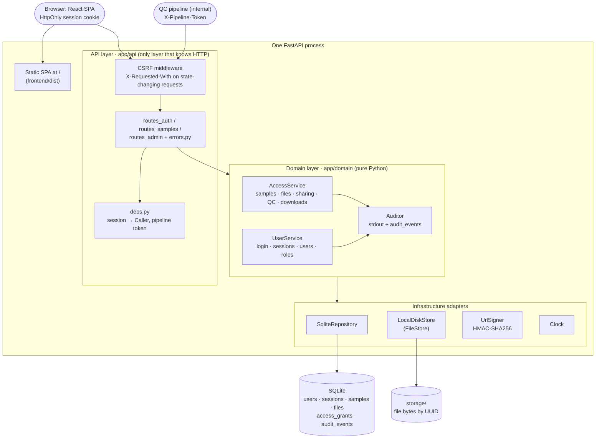
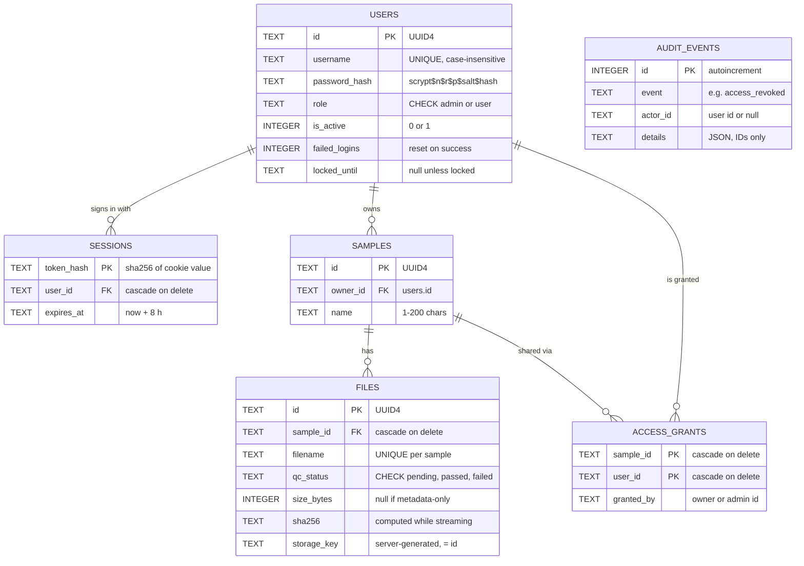
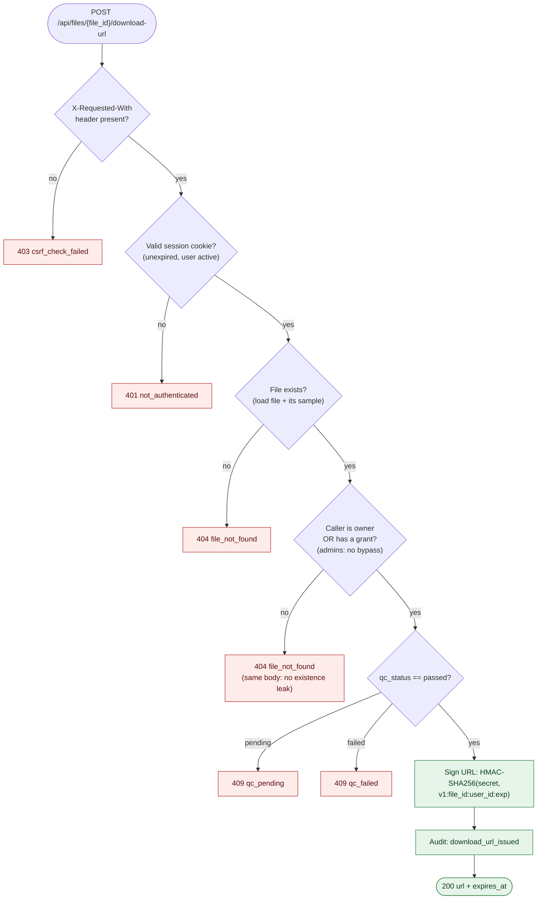
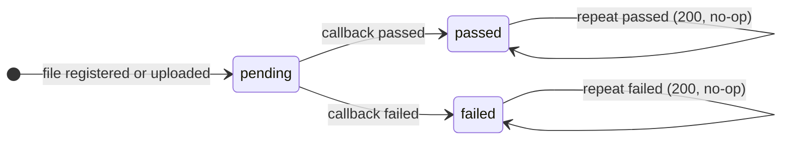
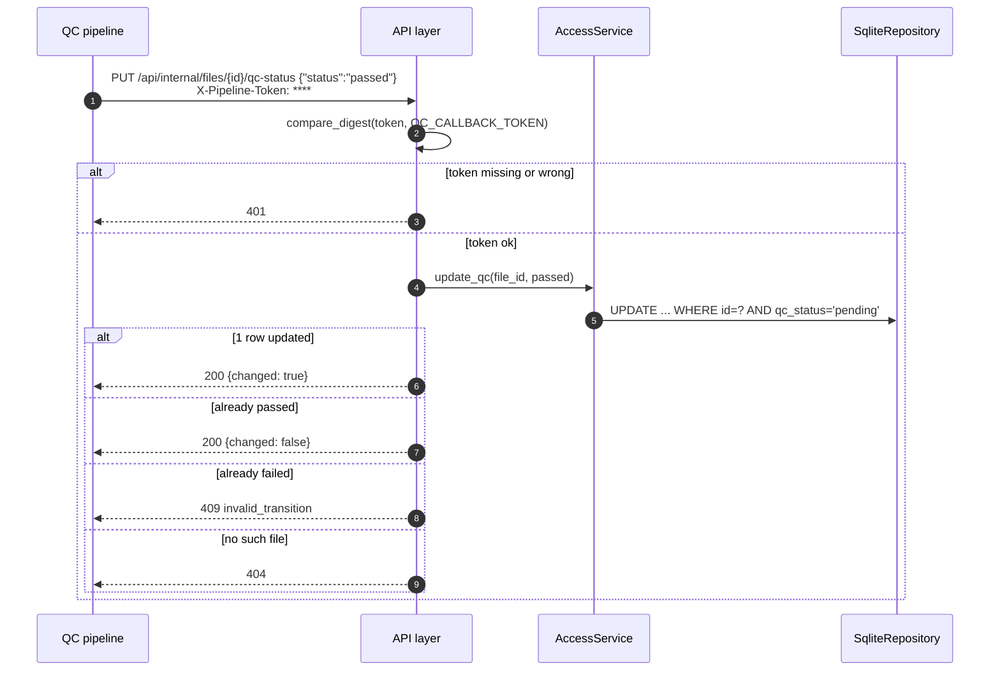
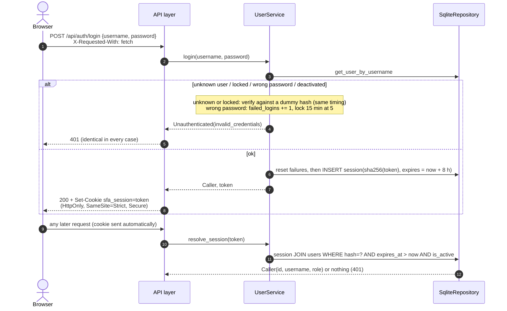
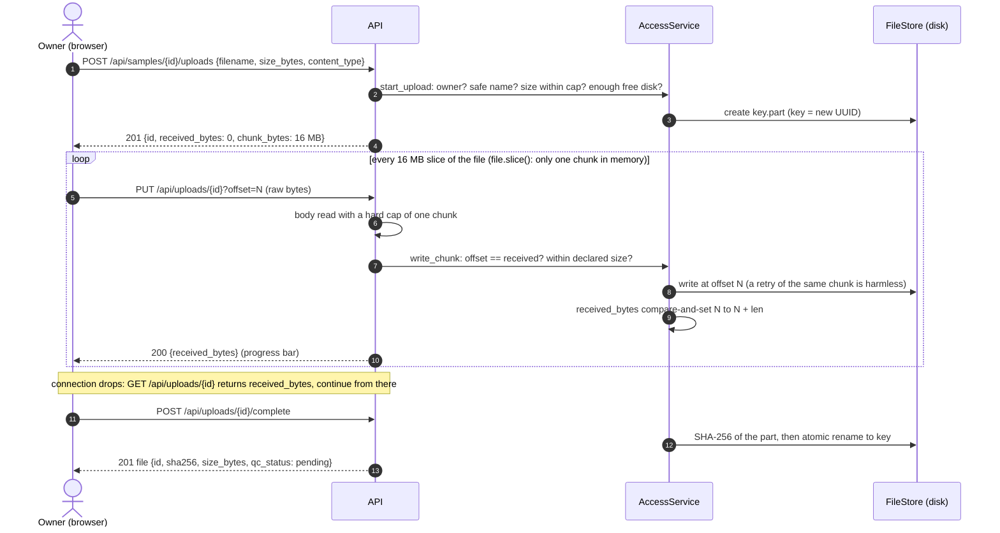
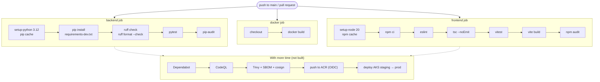
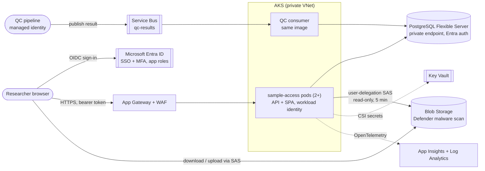
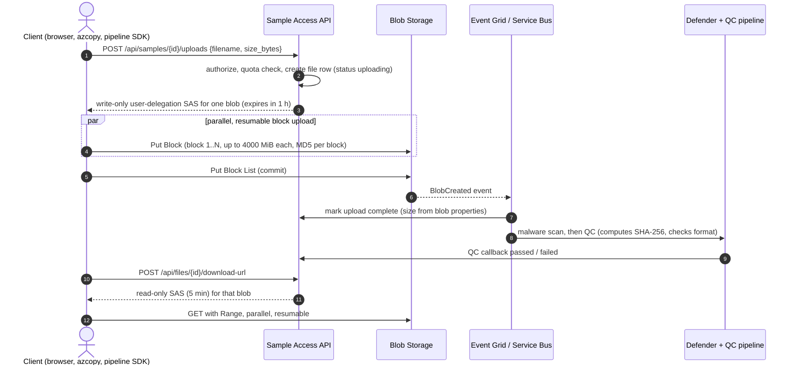

# Sample File Access Service: Implementation Plan

> Design, decisions and trade-offs for a service that controls who may download research data files.
> The [README](../README.md) covers how to run it; this document explains **why it is built the way it is**.

| | |
|---|---|
| **Stack** | Python 3.12 · FastAPI · Pydantic v2 · SQLite (stdlib `sqlite3`) · React 18 + TypeScript (Vite) · pytest · Vitest · ruff · ESLint · GitHub Actions |
| **Time box** | 2–3 h allowed; **just under 3 h used in total (about 2 h 58 min)** (planning, both phases, large-file uploads, three code-review passes with fixes, and docs; see [§0](#0-scope-and-history)) |
| **Phase 1** | The spec's required scope, checkpointed at git tag **`v1-timeboxed`** |
| **Phase 2** | Front end, sign-in, roles, admin dashboard, uploads, revocation, built in the same session within the time box |
| **Diagrams** | Mermaid, rendered natively by GitHub |

## Summary

A FastAPI service with a React front end. All sample, file and access rules live in a plain-Python `AccessService` that is unit-tested without HTTP.

**The download rule:** a user may download a file only if they **own the sample or were granted access to it, _and_ the file's QC status is `passed`**. When both hold, the service returns a 5-minute URL signed with HMAC-SHA256. Access and QC are re-checked every time that URL is used, so revoking a grant stops links that were already issued.

Other key behaviour:
- **No existence leaks.** Unauthorized callers get the same `404` as for something that doesn't exist.
- **QC is a one-way state machine** (`pending → passed | failed`), updated by an idempotent compare-and-set.
- **Sign-in** uses local accounts: scrypt password hashes and server-side sessions in an `HttpOnly`, `SameSite=Strict` cookie, with a CSRF header check and lockout after repeated failures.
- **Two roles.**
  - **Users** register samples, upload and manage their files, and share them.
  - **Admins** manage users and roles, and can grant or revoke access on any sample. They cannot read sample content without an explicit, audited grant.
- **Audit.** Every security-relevant action is written to an audit log that admins can browse.

## Contents

0. [Scope and history](#0-scope-and-history)
1. [Requirements breakdown](#1-requirements-breakdown)
2. [Architecture design](#2-architecture-design)
3. [System design](#3-system-design)
4. [Why this approach: alternatives considered](#4-why-this-approach-alternatives-considered)
5. [Security considerations](#5-security-considerations)
6. [Testing strategy](#6-testing-strategy)
7. [CI/CD](#7-cicd)
8. [Production path on Azure (not built)](#8-production-path-on-azure-not-built)
9. [Known weaknesses and trade-offs](#9-known-weaknesses-and-trade-offs)
10. [Implementation plan and time budget](#10-implementation-plan-and-time-budget)
11. [README outline](#11-readme-outline)

---

## 0. Scope and history

The exercise asked for a small HTTP service, built in **2–3 hours**. **Everything here, including the extensions, was built inside that time box: just under 3 h (about 2 h 58 min) in total**, from creating the repository to the final documentation. That pace was possible because the work was done with an AI coding assistant (see the README).

I worked in two phases. Phase 1 delivered the spec's required scope first, so that a complete, tested submission existed early. It was committed and tagged `v1-timeboxed` as a safe checkpoint. With time left in the box, phase 2 extended it into a usable application.

| | Phase 1: required scope (tag `v1-timeboxed`) | Phase 2: extension (current `main`) |
|---|---|---|
| Time | ~1 h 10 min, including ~55 min of up-front planning | ~35 min, plus ~15 min of documentation updates |
| Identity | `X-User-Id` header (spoofable placeholder) | Local accounts: scrypt hashes, server-side sessions, lockout, CSRF check |
| Roles | Owner + grantees only | `user` and `admin` |
| Files | Registered by name; fake download | Any file type up to 10 GB (local cap) via resumable chunked uploads; SHA-256; range-capable downloads; delete |
| Sharing | Grant only | Grant **and revoke**; revocation kills already-issued URLs |
| UI | None (curl) | React + TypeScript: samples, files, sharing, admin users / samples / audit log |
| Audit | JSON lines to stdout | stdout **and** an `audit_events` table shown in the admin UI |
| Tests | 47 backend | 129 backend + 16 front-end tests |
| CI | lint + test | backend, front-end and Docker jobs; dependency audits; SHA-pinned actions |

**What did not change**, and is still the core of the design:
- the download rule
- 404-instead-of-403
- 409 for files that haven't passed QC
- the QC state machine and its compare-and-set update
- the HMAC-signed URL
- the shared-secret QC callback
- the layered structure with a pure domain

The phase-1 version of this plan can be read with `git show v1-timeboxed:docs/implementation-plan.md`. The actual timeline is in [§10](#10-implementation-plan-and-time-budget).

---

## 1. Requirements breakdown

The domain in one sentence: **a sample owns files; a file has a QC status that a separate pipeline updates asynchronously; a user may download a file only if they are permitted _and_ the file has passed QC.**

### 1.1 Functional requirements

| # | Requirement | Restated precisely | Endpoint(s) |
|---|---|---|---|
| F1 | Register a sample with an owner and zero or more files *(spec)* | The owner is the signed-in caller. Optional `files` registers metadata-only file records (bytes stored elsewhere, e.g. by a pipeline). Every file starts as `pending`. | `POST /api/samples` |
| F2 | Grant a user access to a sample *(spec)* | The owner or an admin grants an existing user, by username. The grant covers every file of the sample. Granting twice is a no-op. | `POST /api/samples/{id}/grants` |
| F3 | QC callback, `pending → passed/failed`, from a trusted pipeline *(spec)* | Set a file's status exactly once. Repeats are idempotent; conflicts are rejected. Protected by a shared-secret header, not by a user session. | `PUT /api/internal/files/{id}/qc-status` |
| F4 | Download request: a time-limited URL only if permitted *(spec)* | Owner or grantee, and QC = `passed`, gives an HMAC-signed URL valid for 5 minutes. | `POST /api/files/{id}/download-url` |
| F4b | The URL must actually work and be time-limited | Verifies signature and expiry, re-checks access and QC, then streams the bytes as an attachment. | `GET /api/downloads/{id}?user&exp&sig` |
| F6 | Sign in / out | Username and password → server-side session cookie. Logout destroys the session. | `POST /api/auth/login`, `POST /api/auth/logout`, `GET /api/auth/me` |
| F7 | Upload and manage files | The owner uploads files of **any type** (video, audio, PDF, PPTX, CSV, text, genomics formats, ...) up to **10 GB** locally, as a resumable series of chunks, and deletes files or the whole sample. | `POST /api/samples/{id}/uploads`, `PUT /api/uploads/{id}?offset=`, `POST /api/uploads/{id}/complete`, `DELETE /api/files/{id}`, `DELETE /api/samples/{id}` |
| F8 | Revoke access | The owner or an admin removes a grant. Takes effect immediately, including for URLs already issued. | `DELETE /api/samples/{id}/grants/{user_id}` |
| F9 | Browse | List my samples (owned + shared), read a sample with its files, list a sample's grants. | `GET /api/samples`, `GET /api/samples/{id}`, `GET /api/samples/{id}/grants` |
| F10 | Admin: manage users and roles | Create users, change role, deactivate or reactivate. | `GET/POST /api/admin/users`, `PATCH /api/admin/users/{id}` |
| F11 | Admin: manage access on any sample | List all samples; grant or revoke on any of them (same endpoints as F2/F8). | `GET /api/admin/samples` |
| F12 | Admin: audit log | Browse security events, newest first, filter by event type. | `GET /api/admin/audit` |
| F13 | Web UI | React single-page app for all of the above, served by the same process at `/`. | `frontend/` |

### 1.2 Non-functional requirements

| Requirement | How it is met |
|---|---|
| Persistence | SQLite via stdlib `sqlite3`, behind a repository. DB constraints (FK with cascade, UNIQUE, CHECK). Uploaded bytes go to a `FileStore` (local disk; Azure Blob in production). |
| Tests | 129 backend tests (domain rules without HTTP, plus API, auth, admin, upload, config, logging and app-wiring tests) and 16 front-end tests ([§6](#6-testing-strategy)). |
| Large files | Any file type; 10 GB local cap (`MAX_UPLOAD_MB`); bounded memory per request; resumable uploads; HTTP Range downloads; refuses uploads that would fill the disk ([§3.8](#38-uploads-large-files-and-downloads)). |
| CI | GitHub Actions: backend (ruff, pytest, pip-audit), front end (ESLint, `tsc`, Vitest, build, npm audit) and Docker build jobs, read-only, actions pinned by SHA ([§7](#7-cicd)). |
| README | Run instructions, choices, alternatives, assumptions, weaknesses, more time ([§11](#11-readme-outline)). |
| Security | Least privilege, no existence leaks, hardened sessions, CSRF defence, safe uploads, audited actions ([§5](#5-security-considerations)). |
| Explainability | Few dependencies: no ORM, no auth library, no UI framework. Every access rule is in `app/domain/service.py`; every account rule is in `app/domain/users.py`. |

### 1.3 Ambiguities and assumptions

| # | Ambiguity | Assumption / decision | Why |
|---|---|---|---|
| A1 | How are users identified? | Local accounts with server-side sessions. The single seam is `get_current_user()` in `app/api/deps.py`. | Runs anywhere with no cloud setup. In production that one function validates a Microsoft Entra ID token instead ([§8](#8-production-path-on-azure-not-built)). |
| A2 | Who creates accounts? | **Admins only**, no self-sign-up. The first admin is seeded from `ADMIN_USERNAME` / `ADMIN_PASSWORD` on first start. | Access to research data should be provisioned, not self-served. |
| A3 | Who owns a sample? | The signed-in caller who registers it. The body cannot set another owner (`extra="forbid"`). | Stops anyone creating samples in someone else's name. |
| A4 | Who can grant and revoke? | The owner, or any admin. A grantee gets `403`; anyone else gets `404`. | The owner controls their data; admins need to fix access across the organisation (people leave, projects end). |
| A5 | Can the owner download without a grant? | Yes. Granting to the owner is `400`. | Ownership implies access. |
| A6 | Can admins read every file? | **No.** Admins see every sample's metadata and manage its sharing, but they download only if they are the owner or were granted. Granting themselves is allowed, and is recorded as `as_admin=true` in the audit log. | Least privilege: managing access is not the same as needing the data. Any escalation is visible. |
| A7 | Is a grant per sample or per file? | Per sample. It covers every file, including files added or QC-passed later. | Matches the spec; keeps the ACL tiny. |
| A8 | Can QC status change after passed/failed? | No. Terminal states are final. Repeating the same value returns `200 changed:false`; the other value returns `409`. | Pipelines retry; silently flipping a QC result on research data is dangerous. |
| A9 | Can the callback set `pending`? | No. `422`. | Re-running QC is a different operation (new file version). |
| A10 | Can files be added after registration? Which types and sizes? | Yes, by upload (owner only). **Any file type** is accepted. The service never interprets or renders the bytes, so there is nothing type-specific to validate. Max **10 GB** per file locally (configurable). Filenames must be unique within a sample. | Research groups store far more than sequencing data (slides, recordings, spreadsheets, reports). Safety comes from how files are *served*, not from guessing what they are. |
| A11 | What about files registered by name only? | Kept for spec compatibility (a pipeline may register files whose bytes live elsewhere). Downloading one returns a small placeholder text body. | Lets the original API keep working unchanged. |
| A12 | What does "trusted internal pipeline" mean? | `/api/internal/*` plus an `X-Pipeline-Token` shared secret. Exempt from the CSRF check because it uses a token, not a cookie. | "Trusted" should not mean "unauthenticated". |
| A13 | How long are URLs and sessions valid? | URLs 5 minutes (`DOWNLOAD_URL_TTL_SECONDS`); sessions 8 hours (`SESSION_TTL_HOURS`). | Short enough to limit damage; long enough for a working day. |
| A14 | What happens when a user is deactivated or their role changes? | All their sessions are deleted immediately; deactivated users can't sign in. Their grants remain but can't be used (no session), and admins can revoke them. | Rights must never outlive a role change. |
| A15 | Is any of this data PHI? | Assume names may be sensitive. Only IDs appear in URLs and in the audit log. | Cancer-centre research data. |

---

## 2. Architecture design

One deployable process: FastAPI serves the JSON API under `/api` **and** the built React app at `/`, so there is a single origin. The backend has three layers, and dependencies point **inward**: the API depends on the domain; the domain depends on small interfaces (repository, file store, signer, clock), never on FastAPI or SQL.

### 2.1 High-level component diagram



| Component | Responsibility | Must NOT do |
|---|---|---|
| **React SPA** (`frontend/`) | Screens for samples, files, sharing and admin. Hides controls the user can't use. | Enforce anything. The backend is the only enforcement point. |
| **API layer** (`app/api`) | Validate input (Pydantic), resolve the session to a `Caller`, check the CSRF header and pipeline token, call one service method, and map domain errors to status codes in one table (`errors.py`). | Contain business rules. |
| **AccessService** | Every sample/file/sharing/QC/download rule; owner vs grantee vs admin. | Know about HTTP, cookies or SQL. |
| **UserService** | Password hashing and verification, lockout, sessions, user and role administration. | Decide sample access. |
| **Auditor** | Write each event to stdout (JSON) and to `audit_events`, IDs only. | Record names, tokens, URLs or passwords. |
| **SqliteRepository** | All SQL, parameterised. Transactions; compare-and-set for QC. | Decide permissions. |
| **FileStore** (`LocalDiskStore`) | Write upload chunks at explicit offsets into `<key>.part`; on completion compute SHA-256 and atomically rename to `<key>`; report free disk space. | Use client-supplied names in paths. |
| **UrlSigner** | Sign and verify `(file, user, expiry)`. | Know about grants. |

### 2.2 Folder / project structure

```text
sample-file-access-service/
├── app/
│   ├── main.py              # create_app(): DB init, admin seed, CSRF middleware, /api router, SPA
│   ├── config.py            # Settings from env; fails fast on missing/weak secrets
│   ├── clock.py             # SystemClock / FrozenClock
│   ├── signing.py           # UrlSigner (HMAC-SHA256)
│   ├── storage.py           # FileStore protocol + LocalDiskStore
│   ├── api/
│   │   ├── deps.py          # per-request connection, services, get_current_user (identity seam)
│   │   ├── errors.py        # domain error → HTTP status (the only place)
│   │   ├── schemas.py       # Pydantic request/response models
│   │   ├── routes_auth.py   # login / logout / me
│   │   ├── routes_samples.py# samples, files, grants, QC callback, downloads
│   │   └── routes_admin.py  # users, all samples, audit log
│   ├── domain/
│   │   ├── models.py        # Caller, Role, User, Sample, File, Grant, ...
│   │   ├── errors.py        # DomainError hierarchy
│   │   ├── service.py       # AccessService: every sample/file/access rule
│   │   ├── users.py         # UserService: passwords, sessions, user admin
│   │   └── audit.py         # Auditor
│   └── persistence/
│       ├── schema.sql
│       └── repository.py
├── frontend/                # Vite + React + TypeScript
│   └── src/  api.ts · upload.ts (chunked uploader) · auth.tsx · App.tsx · components/ · pages/ · test/
├── scripts/simulate_qc.py   # dev helper: plays the QC pipeline
├── tests/                   # test_access_service · test_uploads · test_auth · test_admin · test_api · test_signing
├── docs/implementation-plan.md
├── .github/workflows/ci.yml
├── Dockerfile               # multi-stage: build SPA, run API as non-root
└── README.md
```

### 2.3 How the layers are separated so the rules are testable without HTTP

- **Constructor injection.** `AccessService(repo, signer, clock, audit, store, ...)`. Tests build it directly with a temp SQLite file, a temp storage directory and a `FrozenClock`.
- **The caller is a plain value.** Every method takes `caller: Caller(id, username, role)`. The domain never sees cookies, headers or tokens, so swapping local sessions for Entra ID changes only `get_current_user()`.
- **Typed errors, mapped once.** The domain raises `NotFound`, `Forbidden`, `QcNotPassed`, `PayloadTooLarge` and so on; `app/api/errors.py` is the single table that turns them into status codes.
- **App factory.** `create_app(settings, clock)` builds an isolated app per test with its own DB, storage and secrets. There is no global state.

The core rule (unchanged since phase 1):

```python
def _authorize_download(self, user_id: str, file_id: str) -> File:
    found = self.repo.get_file_with_sample(file_id)            # file JOIN sample
    if found is None or not self._can_access(user_id, found[1]):
        self.audit("download_denied", actor_id=user_id, file_id=file_id, reason="not_found")
        raise NotFound("file")                                 # same error either way
    file = found[0]
    if file.qc_status is not QcStatus.PASSED:
        raise QcNotPassed(file.qc_status)                      # caller is authorized: safe to say why
    return file

def _can_access(self, user_id: str, sample: Sample) -> bool:   # admins get no bypass here
    return user_id == sample.owner_id or self.repo.has_grant(sample.id, user_id)
```

---

## 3. System design

### 3.1 Data model



**Design notes.**
- **Constraints live in the database too**, not only in code: the QC `CHECK`, `UNIQUE (sample_id, filename)`, the grant primary key, and `ON DELETE CASCADE` from samples to files and grants.
- **Only a hash of the session token is stored.** A database leak doesn't hand out live sessions.
- **The audit table** has no foreign keys, so events survive deletion of what they describe.
- **Connections.** One short-lived `sqlite3` connection per request, with `foreign_keys=ON` and `journal_mode=WAL`. Both services in a request share it (FastAPI caches the dependency).
- **Schema** is applied with `CREATE TABLE IF NOT EXISTS`. There is no migration tool yet, so the phase-1 database must be deleted when upgrading.

### 3.2 API design

All routes live under `/api`. Every error, including schema validation (422), unknown routes or methods (404/405) and unexpected failures (500), has one shape: `{"error": {"code": "...", "message": "..."}}`. Validation errors add `details` (field and message, never the submitted value). Every state-changing request (anything but GET, HEAD and OPTIONS; except `/api/internal/*`) must send `X-Requested-With: fetch`, or it gets `403 csrf_check_failed`.

#### Authentication

| Endpoint | Body → Response | Status codes |
|---|---|---|
| `POST /api/auth/login` | `{username, password}` → `{id, username, role}` and sets the `sfa_session` cookie (`HttpOnly; SameSite=Strict; Secure; Path=/; Max-Age=8h`) | 200; **401 `invalid_credentials`** for a wrong password, unknown user, deactivated **or** locked account (deliberately identical); 403 without CSRF header; 422 |
| `POST /api/auth/logout` | → deletes the server-side session (if any) and the cookie | 204, always (even after expiry) |
| `GET /api/auth/me` | → `{id, username, role}` | 200, 401 |

#### Samples, files and sharing (signed-in users)

| Endpoint | Who | Status codes |
|---|---|---|
| `GET /api/samples` | anyone signed in: owned + shared, each with `access` | 200, 401 |
| `POST /api/samples` `{name, files?}` | anyone: becomes owner | 201 (+`Location`), 401, 422 |
| `GET /api/samples/{id}` | owner, grantee, admin (`access: "none"`) | 200, 401, 404 |
| `DELETE /api/samples/{id}` | owner | 204, 401, 403 (grantee/admin), 404 |
| `POST /api/samples/{id}/uploads` `{filename, size_bytes, content_type?}` | owner: starts a resumable upload | 201 `{id, received_bytes, chunk_bytes, expires_at}`, 422 bad filename, 401, 403 (grantee/admin), 404, 409 `duplicate_filename` / `upload_in_progress`, **413** over the cap, **507** not enough disk |
| `GET /api/uploads/{id}` | the uploader: where to resume | 200, 404 (anyone else, or expired) |
| `PUT /api/uploads/{id}?offset=N` (raw bytes, ≤ 16 MB) | the uploader | 200 `{received_bytes}`, 400 `bad_chunk`, 404, 409 `offset_mismatch` (resync and continue), 413 chunk too big |
| `POST /api/uploads/{id}/complete` | the uploader | 201 file `{id, sha256, size_bytes, qc_status: pending}`, 409 `upload_incomplete` |
| `DELETE /api/uploads/{id}` | the uploader: cancel | 204, 404 |
| `DELETE /api/files/{id}` | owner | 204, 401, 403, 404 |
| `GET /api/samples/{id}/grants` | owner, admin | 200, 401, 403 (grantee), 404 |
| `POST /api/samples/{id}/grants` `{username}` | owner, admin | 201 new / 200 existing, 400 grant to owner, 401, 403 (grantee), 404 sample **or `user_not_found`**, 422 |
| `DELETE /api/samples/{id}/grants/{user_id}` | owner, admin | 204, 401, 403 (grantee), 404 sample or `grant_not_found` |

#### QC and downloads

| Endpoint | Who | Status codes |
|---|---|---|
| `PUT /api/internal/files/{id}/qc-status` `{status: passed\|failed}` | pipeline (`X-Pipeline-Token`) | 200 `changed:true/false`, 401, 404, 409 `invalid_transition`, 422 |
| `POST /api/files/{id}/download-url` | owner or grantee (admins only with a grant) | 200 `{url, expires_at}` + `Cache-Control: no-store`, 401, **404** missing *or* not permitted, **409** `qc_pending` / `qc_failed` |
| `GET /api/downloads/{id}?user&exp&sig` | whoever holds a valid URL (the URL is the credential, like a SAS) | 200 bytes as `application/octet-stream` + `Content-Disposition: attachment` + `nosniff`; 403 `invalid_or_expired_link`; 404/409 if access or QC no longer hold |

#### Admin (role `admin`; other signed-in users get `403 admin_required`, anonymous callers `401`)

| Endpoint | Body → Response | Status codes |
|---|---|---|
| `GET /api/admin/users` | → users (no hashes) | 200 |
| `POST /api/admin/users` | `{username, password (≥12), role}` | 201, 409 `username_taken` (case-insensitive), 422 |
| `PATCH /api/admin/users/{id}` | `{role?, is_active?}`. Ends that user's sessions. | 200, 400 `self_update`, 404 |
| `GET /api/admin/samples` | → every sample with the admin's own `access` | 200 |
| `GET /api/admin/audit?limit&event` | → events, newest first | 200 |

Supporting: `GET /api/healthz` runs `SELECT 1`. OpenAPI docs are at `/api/docs` (disable publicly in production).

### 3.3 The download authorization decision



- **Order matters.** Checks run from "who are you" to "may you" to "is it ready". QC is checked only after access, so outsiders can't learn a file's QC status.
- **Admins get no bypass** in `_can_access`. They manage sharing, and can grant themselves, which is audited with `as_admin=true`.
- **The same rule runs again at `/api/downloads`** after the signature check. A revoked grant, a deleted file or a deleted sample stops an already-issued URL.

### 3.4 Roles and permissions

| Action | Owner | Grantee | Admin (no grant) | Anyone else |
|---|---|---|---|---|
| See sample + file list | ✅ | ✅ | ✅ (`access: none`) | 404 |
| Download a QC-passed file | ✅ | ✅ | 404 (must grant self, audited) | 404 |
| Upload / delete files, delete sample | ✅ | 403 | 403 | 404 |
| List / grant / revoke sharing | ✅ | 403 | ✅ | 404 |
| Manage users and roles, view audit log | 403 | 403 | ✅ | 403 |

**Pattern.** `403` only when the caller can already see the resource (so it reveals nothing); `404` otherwise.

### 3.5 Error semantics

| Code | Meaning in this service | Examples |
|---|---|---|
| **400** | Well-formed but makes no sense | Grant to the owner; admin changing their own role |
| **401** | Not signed in / wrong credentials / bad pipeline token | No or expired session; any failed login |
| **403** | Known caller, may see the resource, may not do this; or a security check | Grantee tries to share or delete; user on admin routes; missing CSRF header; invalid or expired signed link |
| **404** | Doesn't exist **or** you may not know it exists | Unknown sample/file; stranger asks for a download; grant to an unknown username |
| **409** | Valid request, but the current state forbids it | Download of pending/failed file; QC passed → failed; duplicate filename; username taken |
| **413** | Declared file size over `MAX_UPLOAD_MB`, or a chunk over `UPLOAD_CHUNK_BYTES` | Starting an 11 GB upload |
| **507** | Not enough free disk for the declared size (+ `MIN_FREE_DISK_MB` reserve) | Starting a 10 GB upload on a full disk |
| **422** | Schema validation | Bad QC value; password < 12 chars; unknown field such as `owner_id` |

> **404 vs 403 for unauthorized access: 404.**
> If outsiders got `403` for real files and `404` for random IDs, the status code alone would confirm which samples exist. In a cancer-research setting even "sample X exists" can be sensitive.
> **Cost:** someone who forgot to ask for access sees "not found". The audit log lets support see what happened.

> **Why 409 (not 403) for QC not passed.**
> The caller *is* permitted; the file isn't ready. `qc_pending` means retry later; `qc_failed` means never. It is safe to say so, because only authorized callers can reach this check.

> **Why every failed login is the same 401.**
> Distinct answers for "no such user", "deactivated" and "locked" would let an attacker enumerate accounts. A dummy scrypt hash is also computed for unknown users, so response *timing* doesn't give it away either. Lockouts are visible to admins in the audit log (`account_locked`).

### 3.6 QC status state machine



| Current | Requested | Result |
|---|---|---|
| pending | passed / failed | 200, `changed: true` |
| passed / failed | the same value again | 200, `changed: false` |
| passed / failed | the other terminal value | 409 `invalid_transition` (+ warning in the audit log) |
| any | pending / other | 422 |

**Atomicity.** One conditional statement, so concurrent callbacks can't both win:

```sql
UPDATE files SET qc_status = :new, qc_updated_at = :now
 WHERE id = :file_id AND qc_status = 'pending';
-- rowcount 1 → transitioned; 0 → re-read: missing → 404, same → 200 no-op, other → 409
```



### 3.7 Sign-in and sessions



- **Server-side sessions, not JWTs.** Logout, deactivation and role changes take effect immediately, because the session row is deleted ([§4.4](#44-user-identification-and-sessions)).
- **Password storage.** `scrypt` (n=2¹⁴, r=8, p=1, 16-byte random salt), verified with `hmac.compare_digest`. The parameters are stored in each hash, so they can be raised later without breaking existing passwords.
- **CSRF.** `SameSite=Strict` stops the browser sending the cookie on cross-site requests. As a second layer, every state-changing request must carry `X-Requested-With`, which a cross-site page can't add without a CORS preflight, and CORS is not enabled.

### 3.8 Uploads, large files and downloads

**File types.** Any type is accepted: video, audio, PDF, PPTX, CSV, plain text, BAM/FASTQ/VCF, archives, files with no extension. The service stores bytes and never interprets, previews or renders them, so there is nothing type-specific to check. Safety comes from how files are **served**: always `application/octet-stream` + `Content-Disposition: attachment` + `nosniff`. Even an uploaded `.html` or `.svg` can never run script on our origin. The browser-reported content type is stored for display only and never trusted.

**Large files (10 GB local cap).** A single multipart POST is the wrong tool for multi-GB files. Starlette spools the whole body to a temp file before the handler runs, so a size limit only applies afterwards, every byte is written twice, a dropped connection means starting over, and a worker is held for the whole transfer. Instead, uploads are **resumable sessions of bounded chunks**, the same shape as Azure block blobs (stage blocks, then commit) and the tus protocol:



| Concern | How it is handled |
|---|---|
| Size cap | Declared up front and checked **before any byte is accepted** (`MAX_UPLOAD_MB`, default 10 GB → 413). The server also refuses a chunk that would go past the declared size. |
| Memory | Each request body is capped at one chunk (`UPLOAD_CHUNK_BYTES`, 16 MB), whatever the file size. The browser reads one slice at a time. |
| Disk | Refused with 507 if free space < declared size + `MIN_FREE_DISK_MB` (1 GB). Each byte is written once (straight into `key.part`). |
| Interruptions | The client retries with backoff, resyncs from `received_bytes`, and never resends stored bytes. Choosing the same file again later (even after a page reload) resumes it; the browser remembers the session ID. |
| Concurrency | A chunk is written at an explicit offset, and the offset moves by compare-and-set, so a duplicated retry is detected (409 `offset_mismatch`) rather than corrupting the file. |
| Workers | The chunk handler is `async`; file and DB I/O run in the thread pool for one chunk at a time, so a slow 10 GB upload doesn't hold a worker for its whole duration. |
| Integrity | SHA-256 is computed over the stored bytes at completion and returned. Clients and the QC pipeline can verify it. |
| Abandoned uploads | Sessions expire after 24 h; their partial bytes are purged. Cancelling deletes them immediately. Only the uploader can see or continue a session. |
| Downloads | Streamed from disk in chunks (constant memory) and **HTTP Range** is honoured (206), so large downloads can resume. The signed URL is checked when a request starts; a resume after the 5-minute URL expires simply requests a new URL. |

**Signed URLs.** The signature binds file, user and expiry (`v1:file_id:user_id:exp`, HMAC-SHA256, base64url). It is compared in constant time and needs no stored state. Because `/api/downloads` re-checks access every time, revoking a grant (or deleting the file or sample) stops outstanding links at once.

**Verified by hand:**
- A 100 MB `video/mp4` uploaded through the UI in 7 chunks; the stored SHA-256 matched the one computed in the browser.
- Starting a 10 GB upload on a nearly full disk returned 507.
- Starting an 11 GB upload returned 413.

**Production.** The bytes should not flow through the API at all. See [§8.1](#81-scaling-file-size-and-throughput).

### 3.9 Protecting the "trusted" QC callback

1. **Separate prefix** `/api/internal/*`, so the ingress can block it from the internet with one rule.
2. **Shared secret** `X-Pipeline-Token`: separate from the signing key, at least 32 characters, compared in constant time.
3. **No user identity accepted.** A user's session cannot change QC.

> **Explicitly a placeholder.** In production the pipeline would use an Entra ID **managed identity** with a `QC.Write` app role, or publish to **Service Bus** so it never calls the API directly.

### 3.10 Concurrency and consistency

| Scenario | Behaviour |
|---|---|
| Two QC callbacks race | Compare-and-set: exactly one wins. The other gets 200 `changed:false` if it asked for the same status, 409 if it asked for the other. |
| Duplicate callback | 200 `changed:false`, no side effects. |
| Same grant created twice | Primary key + `ON CONFLICT DO NOTHING`: one row. |
| Grant revoked after a URL was issued | The URL fails at `/api/downloads` (access re-check). |
| File or sample deleted after a URL was issued | The URL fails (404). Bytes are deleted from storage. |
| Two uploads with the same filename | `UNIQUE (sample_id, filename)` on uploads and on files: the second gets 409. |
| The same chunk is sent twice (client retry) | The chunk is written at an explicit offset, and `received_bytes` moves by compare-and-set, so a duplicate gets 409 `offset_mismatch` and the client resyncs. Nothing is corrupted. |
| Connection drops mid-upload | The bytes already stored stay in `key.part`; the client asks `GET /api/uploads/{id}` and continues from `received_bytes`. |
| Upload abandoned | Sessions expire after 24 h; expired sessions and their partial bytes are purged when the next upload starts. |
| User deactivated or role changed mid-session | All their sessions are deleted; their next request is 401. |
| Registration (sample + N files) partly fails | One transaction: all or nothing. |

---

## 4. Why this approach: alternatives considered

✅ marks the selected option.

### 4.1 Backend language / framework

| Option | Pros | Cons | Verdict |
|---|---|---|---|
| ✅ **Python 3.12 + FastAPI** | Pydantic validation and OpenAPI for free; fast to build; the bioinformaticians' language; mature pytest/TestClient. | Types are hints, not enforced at compile time. | **Selected** |
| TypeScript + Fastify | Compile-time types; same language as the front end. | More setup; less shared with the Python side of the team. | Strong alternative |

### 4.2 Front end

| Option | Pros | Cons | Verdict |
|---|---|---|---|
| ✅ **React + TypeScript (Vite)** | What the team's TypeScript engineers know; typed API client; rich interactions (upload, sharing, admin tables); fast dev server with an `/api` proxy. | A second toolchain (Node) and CI job. | **Selected** |
| Server-rendered (Jinja + htmx) | Python only; one process; less JavaScript. | Further from the team's TypeScript practice; admin interactions get awkward. | Rejected |
| Component library (MUI etc.) | Polished widgets. | More to learn and explain; larger bundle. Plain CSS is enough here. | Rejected |

The SPA is built to static files and **served by FastAPI at `/`**, so the UI and API share one origin. No CORS is needed, and the cookie can be `SameSite=Strict`.

### 4.3 Persistence

| Option | Pros | Cons | Verdict |
|---|---|---|---|
| In-memory | Zero setup. | Lost on restart; no constraints or atomicity. | Rejected |
| ✅ **SQLite (stdlib)** | Real SQL, transactions, FK/UNIQUE/CHECK/cascade; durable; no extra service. | Single writer, single node. | **Selected (build)** |
| PostgreSQL (Azure Flexible Server) | Production-grade, concurrent, managed, Entra auth. | Needs a service in CI and locally. | Production target |

### 4.4 User identification and sessions

| Option | Pros | Cons | Verdict |
|---|---|---|---|
| Header `X-User-Id` (phase 1) | Trivial. | Spoofable. | Replaced |
| ✅ **Local accounts + server-side session cookie** | Reviewers can run it with no cloud setup; instant logout and revocation; `HttpOnly` cookie isn't readable by JavaScript. | We own password storage, lockout and resets; no MFA. | **Selected (build)** |
| JWT in `localStorage` | Stateless. | Readable by any XSS; can't be revoked before expiry; easy to get wrong (`alg` confusion). | Rejected |
| Microsoft Entra ID (OIDC) | Real SSO + MFA + conditional access; university standard. | Needs a tenant and app registration; not runnable by reviewers. | Production target |

The seam is one function, `get_current_user()`. In production it would validate an Entra token and return `Caller(oid, upn, role from app roles)`. Nothing else changes.

### 4.5 Password hashing

| Option | Pros | Cons | Verdict |
|---|---|---|---|
| ✅ **scrypt (stdlib `hashlib`)** | Memory-hard; no new dependency; tunable; parameters stored per hash. | Less common than bcrypt in web frameworks. | **Selected** |
| argon2id (`argon2-cffi`) | Current OWASP first choice. | Adds a compiled dependency. | Good alternative |
| bcrypt | Widely used. | 72-byte input limit; not memory-hard. | Rejected |
| SHA-256 + salt | Fast. | Fast is the problem: cheap to brute-force. | Rejected |

### 4.6 Download URL mechanism

| Option | Pros | Cons | Verdict |
|---|---|---|---|
| ✅ **HMAC-signed URL + re-check on use** | Stateless signature; tamper-proof; revocation works because of the re-check. | Bytes flow through the API. | **Selected (build)** |
| JWT in the URL | Standard format. | Extra dependency and pitfalls; no gain. | Rejected |
| Opaque token in DB | Revocable, single-use possible. | DB write per request; cleanup. | Rejected |
| Azure Blob user-delegation SAS | Storage enforces it; bytes skip the API. | Needs Azure; revocation only via TTL or key revocation. | Production target |

### 4.7 Access model

| Option | Pros | Cons | Verdict |
|---|---|---|---|
| ✅ **ACL (owner + grants) + two roles** | Matches the spec; one table; easy to answer "who can see X?"; the admin role covers organisation-wide access management. | No groups; no per-file grants. | **Selected** |
| Full RBAC (roles × permissions, groups, data stewards) | Scales to labs and projects. | Much more to design and test. | Later |

### 4.8 QC callback transport

| Option | Pros | Cons | Verdict |
|---|---|---|---|
| ✅ **Synchronous REST callback** | What the spec describes; simple; immediate feedback. | Couples availability. | **Selected (build)** |
| Azure Service Bus | Buffering, retries, dead-lettering, de-duplication. | Infrastructure + consumer. The handler is already idempotent. | Production target |
| Polling | No pipeline changes. | Slow, wasteful, needs credentials into the pipeline. | Rejected |

### 4.9 Architecture style

| Option | Pros | Cons | Verdict |
|---|---|---|---|
| ✅ **Layered monolith, one process serving API + SPA** | One deployable, one origin, one transaction per decision; right size for a small team. | Scales as one unit. | **Selected** |
| Microservices / separate front-end hosting | Independent scaling. | Network hops inside authorization; CORS; more pipelines. | Rejected for now |

---

## 5. Security considerations

| Area | In the build | Production / more time |
|---|---|---|
| **Authentication** | scrypt hashes; ≥12-char passwords; identical 401 for every failed login with dummy-hash timing; lockout after 5 failures for 15 min; admin-created accounts only. | Entra ID SSO + MFA + conditional access; password reset flow if local accounts remain. |
| **Sessions** | 32-byte random token; only its SHA-256 stored; `HttpOnly`, `SameSite=Strict`, `Secure` (configurable for local http); 8 h expiry; deleted on logout, deactivation and role change. | Idle timeout; "sign out everywhere"; session list in the UI. |
| **CSRF** | `SameSite=Strict` + required `X-Requested-With` on every state-changing API request (not GET/HEAD/OPTIONS), including login; no CORS. | Same; add `Origin` checking if CORS is ever needed. |
| **Authorization** | Deny by default; every rule is in `AccessService` / `UserService`; admins have no implicit data access; the UI hides controls but is never trusted. | Entra app roles / groups; periodic access reviews. |
| **Information leakage** | 404 for "missing" and "not yours"; QC revealed only to authorized callers; one error for all invalid/expired links; random UUIDs; no stack traces. | Rate limiting per user and IP. |
| **Uploads** | Owner only; any type; declared size checked against the cap (413) and free disk (507) before any bytes are accepted; each request body hard-capped at one chunk; stored under a server UUID (the client's filename never touches the filesystem); filename rules (no separators, control chars, `.`/`..`); SHA-256 recorded; `.part` + atomic rename; only the uploader can see or continue an upload session. | Malware scanning (Defender for Storage) before files become downloadable; per-user and per-project quotas; ingress body-size limit = chunk size. |
| **Downloads** | Re-check on every use; `application/octet-stream` + `attachment` + `nosniff`; `Cache-Control: no-store`. | User-delegation SAS from Blob; IP-restricted SAS. |
| **Input validation** | Pydantic with `extra="forbid"`, lengths, patterns; UUID path params; parameterised SQL only. | WAF. |
| **Secrets** | From env only; startup fails if missing, weak, or if the signing key equals the pipeline token; `.env` and DBs git-ignored; CI needs no secrets. | Key Vault via CSI driver + workload identity; key rotation with `kid`. |
| **Audit** | Every login, lockout, user change, upload, delete, grant, revoke, QC change, URL issue/serve/deny → stdout JSON + `audit_events`, IDs only; admin UI to browse. | Log Analytics with long retention; append-only / immutable store; alerts. |
| **Supply chain** | Exact pins for every direct dependency (npm also has a committed lockfile; Python transitive dependencies are resolved at install time); `pip-audit` and `npm audit --omit=dev` in CI; GitHub Actions pinned to commit SHAs; CI `permissions: contents: read`; container runs as non-root and is built in CI. A review found starlette 0.41.3 (pulled in by FastAPI 0.115) had published CVEs, including a `Range`-header DoS in `FileResponse`; upgraded to FastAPI 0.143 / starlette 1.7, react-router 7.18, vite 6.4, vitest 4.1. | Dependabot, CodeQL, image scan + SBOM + signing. |
| **Logs** | Audit events record IDs only. The uvicorn access log **redacts download signatures** (`sig=REDACTED`), so bearer URLs never reach log storage (tested). | Log Analytics with retention policies. |
| **Headers** | Every response: `X-Frame-Options: DENY`, `X-Content-Type-Options: nosniff`, `Referrer-Policy: no-referrer`. The UI also gets a same-origin-only `Content-Security-Policy`. `ENABLE_DOCS=false` turns off `/api/docs`. | HSTS at the TLS-terminating ingress. |

**Out of scope** (stated in the README): SSO/MFA, password reset, rate limiting, malware scanning, encryption at rest for the local DB and storage directory, backup/restore, multi-tenancy.

---

## 6. Testing strategy

**Shape.**
- **Most tests exercise the domain directly** (fast, no HTTP).
- **API tests** prove wiring, status codes, cookies and headers. Each test builds its own app with a temp DB, temp storage and a `FrozenClock`, so expiry, lockout and session timeouts are tested without sleeping.
- **Password hashing** uses a cheap scrypt cost in tests; the cost is stored in each hash, so the real verification path still runs.
- **Front-end tests** cover the few components with real logic.

### 6.1 Backend (129 tests)

| File | What it proves |
|---|---|
| `test_access_service.py` | D1–D18 from phase 1 (owner/grantee download, 404 for strangers and unknown files, 409 pending/failed, QC state machine, grant rules), plus **R1** revocation kills issued URLs, **R2–R3** revoke rules, **R4** admin manages any sample, **R5** admin sees but can't download without an audited self-grant, **R6** admin can't change content, owner-only delete with cascade, and the audit log never contains names or URLs. |
| `test_uploads.py` | **U1** any type (MP4, PPTX, WAV, PDF, CSV, TXT, BAM, no extension) uploads with the right SHA-256 under a UUID key; **U2** size cap checked before any bytes are sent; 507 when the disk would fill; **U3** an interrupted upload resumes from the last byte and stale retries get `offset_mismatch`; chunk rules (too big, empty, past the declared size, completing early); empty files; **U4** unsafe names rejected; duplicate names; **U5** only the owner can upload, and nobody else can see or continue the session; abort and 24 h expiry remove partial bytes; deleting a sample removes in-progress uploads; **U6** chunked HTTP upload → pending (409) → QC → exact bytes back as an `octet-stream` attachment with `nosniff` (even for `.html`), and a **206 Range** request returns the right slice; **U7** 413 for an over-cap file and an oversized chunk; resume over HTTP; metadata-only placeholder. |
| `test_auth.py` | scrypt round-trip and salting; **AU1** hardened cookie; **AU2** wrong password ≡ unknown user; **AU3** lockout after 5 failures, unlocked after 15 min; **AU4** session expiry; **AU5** logout kills the server session (replayed cookie fails); **AU6** CSRF header required (including login); **AU7** deactivation signs the user out and blocks login. |
| `test_admin.py` | **AD1** users get 403 on every admin route; **AD2** create user, case-insensitive duplicate → 409, weak password → 422; **AD3** role change ends old sessions; **AD4** admin can't change themselves; **AD5** admin grant + revoke on someone else's sample, revoked URL stops, admin has no own download right; **AD6** audit list ordering and filter. |
| `test_api.py` | Happy path end to end; listings reflect access; identical 404 bodies; 409 codes; QC callback auth and transitions; expired/tampered link 403 with an identical body; grant permissions incl. `user_not_found`; owner deletes; 422 validation; unknown `/api` route is 404. |
| `test_signing.py` | Valid, expired, tampered (file, user, exp, sig, non-ASCII) and wrong-secret signatures. |
| `test_config.py` | Startup refuses missing, short or identical secrets, half-set admin credentials and invalid limits; values are read from the environment. |
| `test_logging.py` | The access log redacts the signature of a download URL and keeps the rest. |
| `test_app.py` | UI files and client routes served; path traversal outside `dist` blocked; unknown API paths 404 and wrong methods 405 (never the UI); security headers and CSP; `/api/docs` can be disabled; a clear startup error when the admin username collides with an existing user. |

### 6.2 Front end (16 Vitest + Testing Library tests)

| Component | What it proves |
|---|---|
| `uploadFile` (`upload.ts`) | Sends the file in chunk-sized slices with exact progress; resumes a previous upload of the same file from the server's offset; after a network error waits, resyncs and retries without resending stored bytes; does not retry client errors. |
| `FileRow` | Download is disabled while QC is pending or failed, and for an admin with `access: none`; enabled for a grantee on a passed file; Delete only appears when the owner may delete. |
| `RequireAuth` / `RequireAdmin` | Anonymous users are sent to sign-in; users don't see admin pages; admins do. |
| `LoginPage` | Submits the credentials and shows the server's error message. |

### 6.3 Manual end-to-end check (done before submission)

1. Admin signs in and creates alice and bob.
2. Alice registers a sample and uploads a file; Download is disabled while it's pending.
3. `scripts/simulate_qc.py <id> passed` marks it passed.
4. Alice grants bob. Bob sees the sample as a grantee and downloads the exact bytes.
5. The admin opens the sample (sees `access: none`, Download disabled) and revokes bob. Bob's previously issued URL now returns 404.
6. The audit log shows every step, with IDs only.

The run also found and fixed a bug: after one user signed out, the next user was sent to the previous user's last page.

---

## 7. CI/CD



The workflow file is `.github/workflows/ci.yml`:
- Three parallel jobs: **backend** (ruff, pytest, `pip-audit`), **frontend** (ESLint, `tsc`, Vitest, build, `npm audit --omit=dev --audit-level=high`) and **docker** (builds the image).
- Actions pinned to **full commit SHAs**, with the release in a comment (tags can be moved).
- `permissions: contents: read`.
- `concurrency` cancels superseded runs.
- Timeouts on every job.
- **No secrets needed**: tests generate their own.

The **Dockerfile** is multi-stage: Node builds the SPA, then `python:3.12-slim` runs uvicorn as a non-root user with `/data` as a volume. CI builds it on every push. It was not built on the author's machine, which has no Docker.

---

## 8. Production path on Azure (not built)



| Concern | Production choice | Change from the build |
|---|---|---|
| Identity | Entra ID (OIDC, MFA, conditional access). App roles `Admin` / `User`. | Replace `get_current_user()`; drop local passwords and sessions. Admin user management becomes Entra group management. |
| Compute | AKS: ≥2 replicas, probes on `/api/healthz`, HPA, PDB, NetworkPolicy, non-root read-only container. | Manifests or Helm; the Dockerfile already exists. |
| Database | PostgreSQL Flexible Server, private endpoint, Entra auth, PITR; Alembic migrations. | `PostgresRepository` behind the same interface. |
| Files | Blob Storage, private; uploads and downloads go **directly** via short-lived user-delegation SAS; Defender for Storage scans uploads before QC. See [§8.1](#81-scaling-file-size-and-throughput). | `AzureBlobStore` + `BlobSasSigner` replace `LocalDiskStore` + `UrlSigner`. |
| QC events | Service Bus with de-duplication and a dead-letter queue. | New consumer calling `AccessService.update_qc`. |
| Secrets | Key Vault + CSI driver + workload identity. | Config reads mounted values. |
| Observability | OpenTelemetry → App Insights; audit events → Log Analytics with long retention; alerts on 5xx, dead-letter depth, `account_locked` and `download_denied` spikes. | Add instrumentation; ship `audit_events`. |

### 8.1 Scaling file size and throughput

The local build tops out where a single server does: one machine's disk, network link and CPU, with every byte passing through the API process. That's fine up to the 10 GB local cap. Production removes the API from the data path entirely and keeps it only as the **control plane** (who may upload or download, and what state a file is in).



| Dimension | Local build | Production design | Limit it reaches |
|---|---|---|---|
| Max file size | 10 GB (`MAX_UPLOAD_MB`) | Azure block blob: 50,000 blocks × 4,000 MiB | ~190.7 TiB per file |
| Upload path | Browser → API → local disk, 16 MB chunks | Client → **Blob directly** with a write-only SAS for one blob; the API only issues the SAS and records the result | Blob account ingress (~60 Gbps for standard accounts; higher on request) |
| Parallelism | One chunk at a time | Many blocks in parallel (`azcopy`, Azure SDK `max_concurrency`) | Client bandwidth |
| Resume | Server-side session + `received_bytes` | Uncommitted blocks are kept for 7 days; the SDK or `azcopy` resumes | — |
| Integrity | SHA-256 at completion | `Content-MD5` per block checked by Blob on write; the QC pipeline computes SHA-256 while reading the file anyway | — |
| Completion | `complete` hashes the file in the API (~10–30 s for 10 GB) | Blob commit + `BlobCreated` event → Service Bus → consumer updates the file row; no API work proportional to size | — |
| Malware | Not scanned | Defender for Storage scans on upload; the file can't pass QC until the scan is clean | — |
| Download | API streams from disk, Range supported | Read-only SAS, 5 min; Blob serves Range requests in parallel; optional Azure Front Door/CDN for popular files | Blob egress limits |
| Storage cost | Local disk | Lifecycle rules: Hot → Cool after 30 days → Archive after 180 days for raw data; immutability (WORM) policies for regulated datasets | — |
| Very large datasets (TBs, many files) | — | `azcopy` with SAS for bulk transfers; **Azure Data Box** for offline transfer of 10s–100s of TB; ADLS Gen2 hierarchical namespace for directory-style datasets | — |
| API scaling | One process | Stateless pods behind App Gateway; HPA on CPU/RPS; Postgres for state. Pods never touch file bytes, so they stay small | — |
| Quotas | Free-disk check only | Per-user and per-project quotas checked when the SAS is issued; Azure Monitor alerts on capacity | — |

**What stays the same:** the rules. `start_upload` still checks ownership, filename and size, and the download rule and QC state machine don't change. Only the `FileStore` / `UrlSigner` adapters are replaced (`AzureBlobStore`, `BlobSasSigner`), plus a Service Bus consumer for completion events.

---

## 9. Known weaknesses and trade-offs

| # | Weakness | Impact | Fix |
|---|---|---|---|
| W1 | Local accounts: no SSO, MFA or password reset | Weaker than university SSO; admins must reset passwords by recreating accounts. | Entra ID. |
| W2 | Static shared token for the QC callback | No per-caller identity or rotation. | Managed identity + app role, or Service Bus. |
| W3 | File bytes flow through the API; local disk storage; 10 GB cap | Single node; throughput limited to one server's network and disk; completing a 10 GB upload hashes it in one request (~10–30 s). | Direct-to-Blob uploads ([§8.1](#81-scaling-file-size-and-throughput)). |
| W4 | No malware scanning of uploads | A malicious file could be shared (it is never rendered in our origin, but could be downloaded). | Defender for Storage; block download until scanned. |
| W5 | SQLite: single writer, single node | No horizontal scaling or HA. | PostgreSQL. |
| W6 | No rate limiting beyond login lockout | Lockout can be used to lock out a known user (denial of service). | Per-IP rate limits at ingress; CAPTCHA or step-up after failures. |
| W7 | Signed URL is a bearer token for up to 5 min | Anyone holding a leaked URL can use it (the re-check still stops it after revocation). | Short TTL; IP-bound SAS. |
| W8 | QC results can't be corrected | Needs a manual DB fix. | Audited admin override or file versions. |
| W9 | No migrations | Upgrading from phase 1 means deleting the DB. | Alembic. |
| W10 | Audit log is in the same DB as the data | An attacker with DB write access could tamper with it. | Ship to an append-only external store. |
| W11 | Image built in CI but not scanned | Vulnerable OS packages in the base image would go unnoticed. | Trivy + SBOM in CI. |
| W12 | No groups; per-user grants only | Large labs need many grants. | Group principals (Entra groups). |
| W13 | Username enumeration via grants | Any signed-in user can learn whether a username exists (`user_not_found`). | Accepted: usernames aren't secret in an organisation and owners need the feedback; rate-limit if needed. |
| W14 | Upload concurrency edges | Simultaneous different bytes for one chunk offset can leave the loser's bytes (uploader's own file only; the SHA-256 reflects what was stored). The free-disk check is check-then-act. Abandoned uploads are purged when the next upload starts. | Per-upload lock; quotas; a purge timer. With Blob, block IDs and storage quotas solve it. |
| W15 | No pagination | Large lists return in full. | Keyset pagination. |
| W16 | One moderate Vite dev-server advisory (`server.fs.deny` bypass) | Development only; not in the production build; the dev server listens on localhost. | Upgrade to vite 6.4.5 once it is two weeks old. |

**Resolved from phase 1:** the spoofable identity header (W1 then) and the lack of revocation (W4 then).

---

## 10. Implementation plan and time budget

### Actual timeline (2–3 h allowed, about 2 h 58 min used)

Times come from the repository's commit and file timestamps.

| Clock time | Elapsed | Step | Output |
|---|---|---|---|
| 12:56 → 13:51 | ~55 min | **Plan** | Requirements, assumptions, design decisions, diagrams; this document committed |
| 13:51 → 14:04 | ~15 min | **Phase 1: required scope** | Domain, SQLite repository, signer, FastAPI layer, 47 tests, CI, README. Committed and tagged `v1-timeboxed` |
| 14:04 → 14:25 | ~20 min | **Phase 2: backend** | Users, sessions, roles, uploads, revocation, admin API, audit table; 90 tests |
| (same window) | ~15 min | **Phase 2: front end** | React app, 9 component tests, CI job, Dockerfile, QC helper script |
| ~14:20 | ~5 min | **Manual end-to-end check** | Full flow in a browser; one bug found and fixed (§6.3) |
| 14:25 → 14:39 | ~15 min | **Docs** | This document and the README updated |
| 14:39 → 14:53 | ~15 min | **Large-file uploads** | Any file type; resumable chunked uploads up to 10 GB; free-disk check; Range downloads; progress, resume and cancel in the UI; 13 more backend and 5 more front-end tests; verified with a 100 MB upload in the browser; docs |
| 14:53 → 15:20 | ~25 min | **Code review and fixes** | Strict self-review: upgraded vulnerable dependencies, redacted signed URLs from the access log, made upload completion crash-safe, added security headers, unified the error shape, pinned CI actions by SHA and added audits and a Docker build job; 17 more backend tests |
| 15:20 → 15:36 | ~15 min | **Second review and fixes** | Fresh pass plus an independent reviewer: issued download URLs now die when a user is deactivated; navigating away keeps uploads resumable; file IDs shown in the UI; `.env.example` no longer breaks Docker; no 500s on NUL paths or missing bytes; `user` in download URLs validated; HEAD supported; lockout window; expired-session purge; 7 more backend and 2 more front-end tests |
| 15:36 → ~15:54 | ~18 min | **Final review and fixes** | Clean-clone run of the README plus an independent reviewer: HEAD no longer reaches download links (it was writing phantom `download_served` audit rows); every 405 lists all allowed methods; unexpected errors return the standard JSON shape; `.env.example` safe for `docker run --env-file`; status-code tables corrected; 2 more backend tests |

### How the time box was managed

- **Required scope first.** Phase 1 delivered everything the spec asks for, fully tested, before any extension started. Tagging it meant a complete submission existed even if the extension had to be abandoned.
- **Cut line for phase 2** (drop in this order if time ran short): the audit-log page → the Dockerfile → the front-end component tests. Nothing had to be cut.
- **Still deliberately out of scope**, even with time left over: SSO/MFA, cloud infrastructure, malware scanning, migrations ([§8–9](#8-production-path-on-azure-not-built)). These need an Azure tenant or are larger than the box allows.

The original phase-1 step plan (estimated 150 min for that scope alone, before the AI-assisted pace was known) is in the `v1-timeboxed` version of this document.

---

## 11. README outline

| README section | Content | Source |
|---|---|---|
| Overview + time-box note | What it does; built within the time box; tag `v1-timeboxed` checkpoint | [§0](#0-scope-and-history), [§10](#10-implementation-plan-and-time-budget) |
| How to run it | Env (secrets, admin seed, `COOKIE_SECURE=false` locally); backend; `npm run dev`; single-process production build; Docker; tests | [§2.2](#22-folder--project-structure), [§7](#7-cicd) |
| Using it | UI walkthrough + `simulate_qc.py` | [§6.3](#63-manual-end-to-end-check-done-before-submission) |
| API summary | Endpoint table | [§3.2](#32-api-design) |
| Roles | Permissions matrix | [§3.4](#34-roles-and-permissions) |
| Key choices · alternatives rejected | Short versions | [§3–4](#4-why-this-approach-alternatives-considered) |
| Assumptions | A1–A15 condensed | [§1.3](#13-ambiguities-and-assumptions) |
| Security notes | Condensed | [§5](#5-security-considerations) |
| Known weaknesses · more time | W1–W16; Azure path | [§8–9](#8-production-path-on-azure-not-built) |
| Use of AI tools | Honest paragraph | — |
