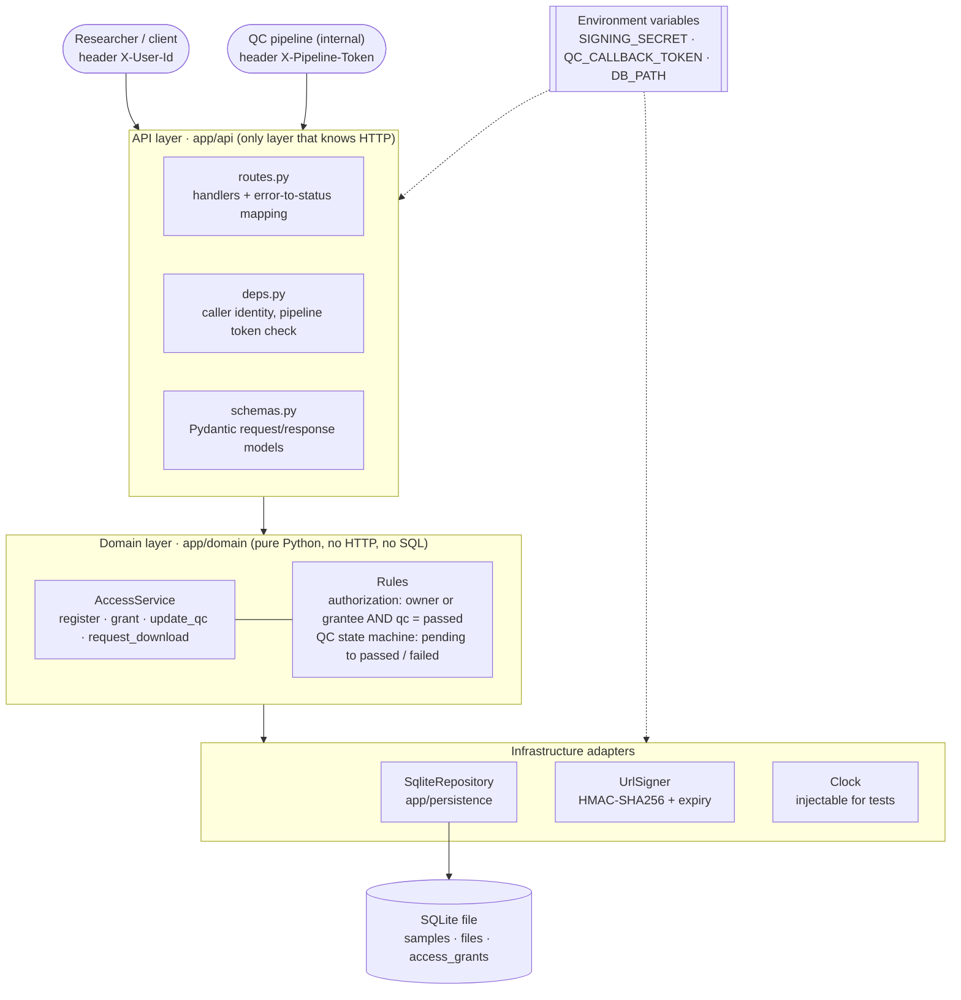
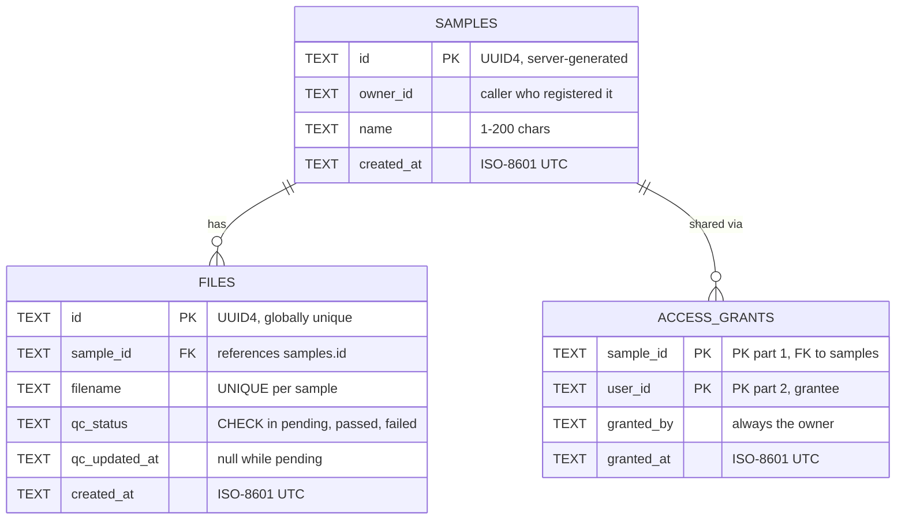
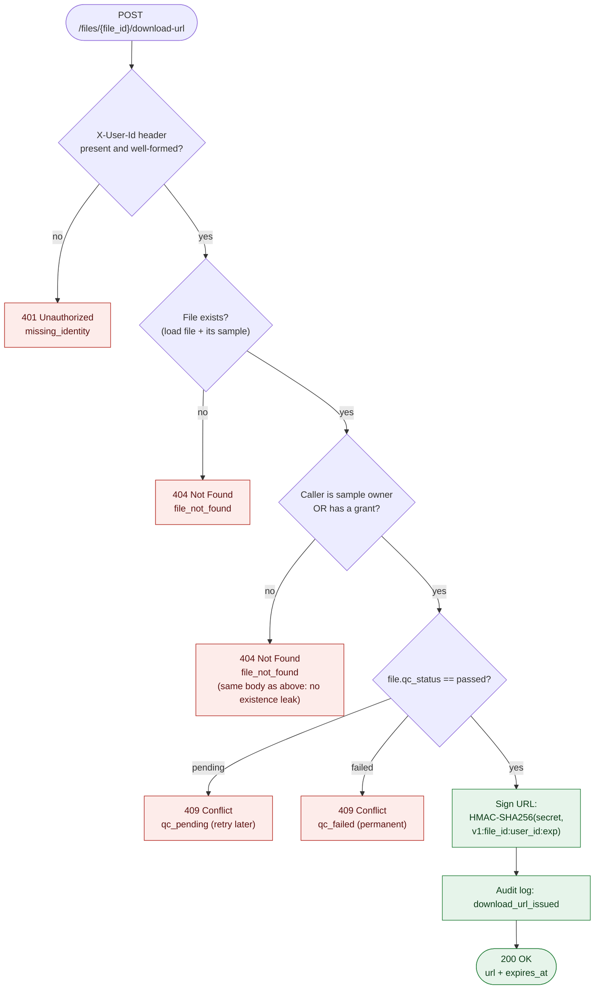
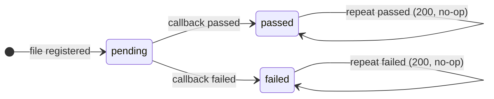
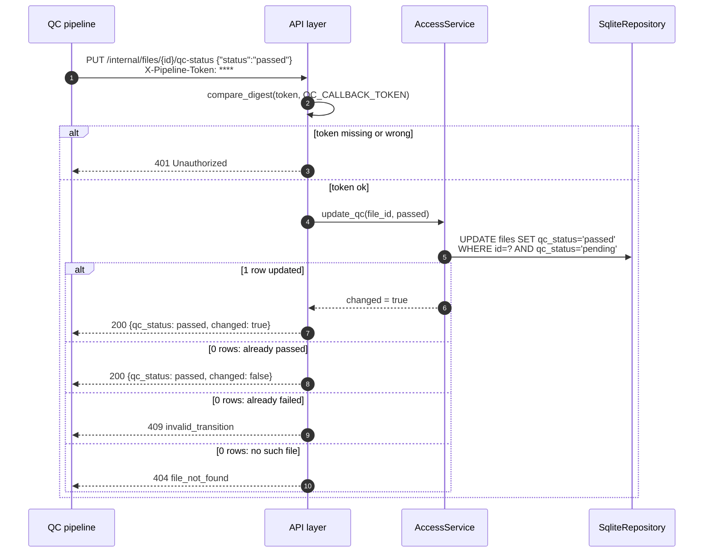
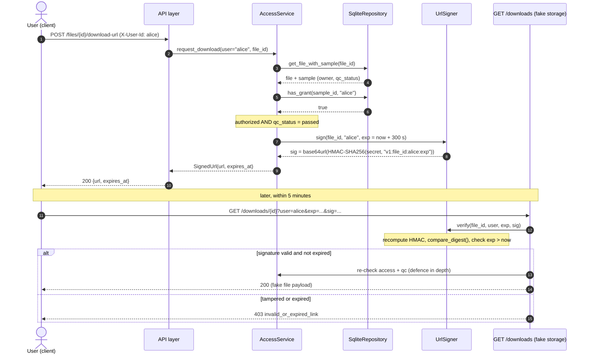
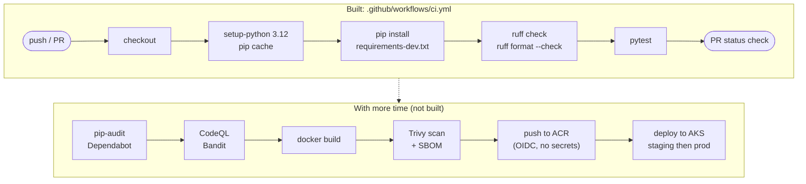
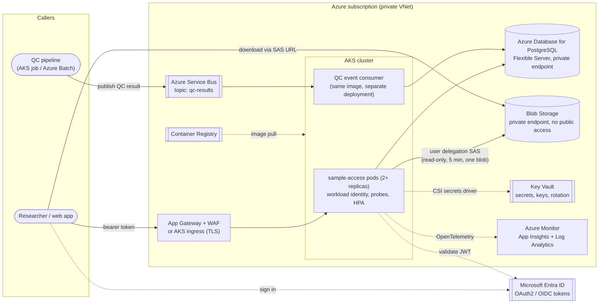

# Sample File Access Service: Implementation Plan

> Design, decisions, trade-offs and a 2.5-hour build plan for the take-home exercise.
> This plan was written **before** any code. If the build differs from it, the [README](../README.md) records where and why.

| | |
|---|---|
| **Time box** | ~2.5 h build (the spec allows 2–3 h). Anything beyond it is documented as "With more time" and not built. |
| **Stack** | Python 3.12 · FastAPI · Pydantic v2 · SQLite (stdlib `sqlite3`) · pytest · ruff · GitHub Actions |
| **Diagrams** | Mermaid, rendered natively by GitHub |

## Summary

A small Python/FastAPI service, layered so that all access rules live in a plain-Python `AccessService` that can be unit-tested without HTTP. State is kept in SQLite through a thin repository.

A user may download a file only if they **own the sample or were granted access, _and_ the file's QC status is `passed`**. When both hold, the service returns a 5-minute URL signed with HMAC-SHA256. Unauthorized callers get the same `404` as for a file that does not exist, so they learn nothing about it.

QC is a one-way state machine (`pending → passed | failed`). Repeated callbacks are idempotent, and the update is an atomic compare-and-set.

Anything beyond the time box (Entra ID, Postgres, real Blob SAS, Service Bus, image scanning, AKS deployment) is described here as the production path and is **not built**.

## Contents

1. [Requirements breakdown](#1-requirements-breakdown)
2. [Architecture design](#2-architecture-design)
3. [System design](#3-system-design)
4. [Why this approach: alternatives considered](#4-why-this-approach-alternatives-considered)
5. [Security considerations](#5-security-considerations)
6. [Testing strategy](#6-testing-strategy)
7. [CI/CD](#7-cicd)
8. [Production path on Azure (not built)](#8-production-path-on-azure-not-built)
9. [Known weaknesses and trade-offs](#9-known-weaknesses-and-trade-offs)
10. [Implementation plan and time budget](#10-implementation-plan-and-time-budget)
11. [README outline](#11-readme-outline)

---

## 1. Requirements breakdown

The domain in one sentence: **a sample owns files; a file has a QC status that a separate pipeline updates asynchronously; a user may download a file only if they are permitted _and_ the file has passed QC.**

### 1.1 Functional requirements

| # | Requirement (spec) | Restated precisely | Endpoint |
|---|---|---|---|
| F1 | Register a sample with an owner and zero or more files | Create a sample whose owner is the calling user. Create 0..N file records with it, each starting with `qc_status = pending`. Return server-generated IDs for the sample and each file. | `POST /samples` |
| F2 | Grant a user access to a sample | The sample owner adds a grant `(sample_id, user_id)`. The grant covers every file of that sample, including future QC changes. Granting the same user twice is a no-op. | `POST /samples/{id}/grants` |
| F3 | QC callback (`pending → passed/failed`), called by a trusted internal pipeline | Set a file's status from `pending` to `passed` or `failed` exactly once. Repeats with the same value succeed without change. Conflicting changes are rejected. The route is protected by a shared-secret header. | `PUT /internal/files/{id}/qc-status` |
| F4 | Download request: return a fake time-limited URL only if permitted | If the caller is the owner or a grantee, and the file is `passed`, return an HMAC-signed URL that expires in 5 minutes. Otherwise return the specific error from [§3.4](#34-error-semantics). | `POST /files/{id}/download-url` |
| F4b | *Implied:* the URL must actually be time-limited | A tiny endpoint verifies the signature and expiry, so "expired URL is rejected" can be demonstrated and tested. It stands in for the storage service. | `GET /downloads/{id}?user&exp&sig` |
| F5 | *Supporting* | Liveness/readiness for containers. Read a sample (owner or grantee) so a demo can show file IDs and statuses. | `GET /healthz`, `GET /samples/{id}` |

### 1.2 Non-functional requirements

| Requirement | What the spec says | How the plan meets it |
|---|---|---|
| Persistence | In-memory or SQLite is fine; pick what you would defend. | SQLite file via stdlib `sqlite3`. Data survives restarts, and the database enforces constraints (FK, UNIQUE, CHECK) and atomic updates. Hidden behind a repository so it can be swapped for Postgres ([§4.2](#42-persistence)). |
| Tests | A small set covering the access logic. | About 20 domain unit tests (no HTTP) plus about 6 API tests through FastAPI's `TestClient` ([§6](#6-testing-strategy)). |
| CI | Minimal GitHub Actions workflow that lints and runs tests. | `ci.yml`: `ruff check` + `ruff format --check` + `pytest` on push and PR, with least-privilege `permissions` ([§7](#7-cicd)). |
| README | How to run, key choices, rejected alternatives, assumptions, known weaknesses, more time. | Outline in [§11](#11-readme-outline), mapped to this document. |
| Time box | 2–3 h; do not go over. | 150-minute plan with a buffer and an explicit cut line ([§10](#10-implementation-plan-and-time-budget)). |
| Explainability | "Build what you can explain." | Few dependencies, no ORM, no framework magic beyond FastAPI dependency injection. Every rule lives in one file (`service.py`). |

### 1.3 Ambiguities and assumptions

The spec is deliberately short. These assumptions are repeated in the README.

| # | Ambiguity | Assumption / decision | Why |
|---|---|---|---|
| A1 | How are users identified? No auth is in scope. | The caller's identity is the `X-User-Id` header, an opaque string matching `^[A-Za-z0-9._@-]{1,128}$`. Missing or malformed → `401`. | Keeps identity out of the domain. In production the same value comes from a validated Entra ID token (`oid` claim). Clearly flagged as spoofable ([§9](#9-known-weaknesses-and-trade-offs)). |
| A2 | Is there a user registry? What is an "unknown user"? | No users table. Users are owned by the identity provider. An "unknown" user is simply one with no ownership or grants, and gets the same `404` as any unauthorized user. Grants may name a user who has never called the API. | Building user management would be out of scope and duplicate Entra ID. Granting before first login is a normal workflow. |
| A3 | Who is the owner at registration? | The owner is the caller (`X-User-Id`). The body has no `owner_id` field. | Stops anyone from creating samples in someone else's name. If a LIMS needs to register on behalf of users, that becomes a separate service identity with its own permission. |
| A4 | Who can grant access? | Only the owner. A grantee trying to grant gets `403`. Anyone else gets `404`. | The simplest rule that is safe. Re-sharing by grantees is a policy decision for the data owner, not something to assume. |
| A5 | Can the owner download without an explicit grant? | Yes. Ownership implies access. Granting to the owner is rejected with `400` because it is meaningless. | Otherwise the owner would have to grant themselves, which is surprising and error-prone. |
| A6 | Is a grant per sample or per file? | Per sample, as the spec says. It covers every file of the sample. | Matches the spec wording and keeps the access-control table tiny. |
| A7 | Can QC status change after passed/failed? | No. `passed` and `failed` are terminal. A conflicting change returns `409`. Repeating the same terminal value returns `200` with `changed: false`. | The spec shows only `pending → passed/failed`. Pipelines retry, so repeats must be safe. Silent flips (passed → failed) on research data are dangerous and should need an explicit admin flow. |
| A8 | Can the callback set status back to pending? | No. Only `passed` or `failed` are accepted; `pending` → `422`. | "Re-run QC" is a different business operation (new file version) and out of scope. |
| A9 | Can files be added after registration? | Not in this build. Files are only created at registration. Filenames must be unique within a sample. Zero files is allowed. | The spec only describes registration with files. Adding files later is a small endpoint for later. |
| A10 | What does "trusted internal pipeline" mean? | The callback lives under `/internal/` and requires an `X-Pipeline-Token` that matches a server secret (constant-time compare). Bad or missing → `401`. | "Trusted" should not mean "unauthenticated". This is a stand-in for managed identity or mTLS plus network isolation ([§3.7](#37-protecting-the-trusted-qc-callback)). |
| A11 | How does the pipeline identify a file? | By the server-generated file UUID returned at registration. File IDs are globally unique, so routes are flat (`/files/{id}`). | Avoids needing the sample ID in every callback. UUID4s are unguessable, which helps against enumeration. |
| A12 | What is the "fake" download URL? | An HMAC-signed URL to this service's own `/downloads` route, which checks the signature and expiry and returns a placeholder body. No real bytes or storage. | Shows the real mechanism (bound to file, user and expiry) without needing Azure. In production this becomes a Blob SAS URL ([§8](#8-production-path-on-azure-not-built)). |
| A13 | How long is "time-limited"? | 5 minutes by default, configurable via `DOWNLOAD_URL_TTL_SECONDS`. | Long enough to start a download, short enough to limit damage if leaked. |
| A14 | Can grants be revoked? Can samples be deleted? | Not in this build. | Not asked for. Revocation is the first thing I would add ([§9](#9-known-weaknesses-and-trade-offs)). |
| A15 | Is any of this data PHI? | Assume sample names and filenames could be sensitive. They are never put in signed URLs or logs (only IDs are). | Cancer-center research data. Cheap to do right from the start. |

---

## 2. Architecture design

One deployable process with three layers (a "layered monolith" with a hexagonal flavour). Dependencies point **inward**: the API layer depends on the domain, and the domain depends on small interfaces (repository, signer, clock), never on FastAPI or SQL.

### 2.1 High-level component diagram



| Component | Responsibility | Must NOT do |
|---|---|---|
| **API layer** (routes, deps, schemas) | Parse and validate HTTP input (Pydantic). Extract the caller identity and check the pipeline token. Call one service method. Map domain errors to HTTP status codes in one place. | Contain business rules ("is this user allowed?"). |
| **Domain layer** (AccessService, models, errors) | All rules: ownership, grants, the QC state machine, the download authorization decision, audit events. Raises typed errors (`NotFound`, `Forbidden`, `QcNotPassed`, `InvalidTransition`, `BadRequest`). | Import FastAPI, read env vars, or know HTTP status codes. |
| **Repository** (SqliteRepository) | Store and load samples, files and grants. Atomic compare-and-set for QC updates. Parameterised SQL only. | Decide permissions. |
| **UrlSigner** | `sign(file_id, user_id, exp)` → URL; `verify(...)` → bool. HMAC-SHA256 with a server secret, constant-time compare. | Know about samples or grants. |
| **Clock** | Returns "now". Injected so tests can freeze or advance time (expiry tests need no `sleep`). | — |
| **Config** | Reads env vars once at startup. Fails fast if `SIGNING_SECRET` or `QC_CALLBACK_TOKEN` is missing or shorter than 32 bytes. | Provide insecure defaults. |

### 2.2 Folder / project structure

```text
sample-file-access-service/
├── app/
│   ├── __init__.py
│   ├── main.py              # create_app(settings): wires repo, signer, clock, service
│   ├── config.py            # Settings from env (fail fast on missing secrets)
│   ├── api/
│   │   ├── routes.py        # thin HTTP handlers + exception handlers (domain error → status)
│   │   ├── deps.py          # get_caller_id (X-User-Id), require_pipeline_token, get_service
│   │   └── schemas.py       # Pydantic request/response models with length/pattern limits
│   ├── domain/
│   │   ├── models.py        # QcStatus enum, Sample, File, Grant, SignedUrl dataclasses
│   │   ├── errors.py        # DomainError hierarchy
│   │   └── service.py       # AccessService: ALL business rules live here
│   ├── persistence/
│   │   ├── schema.sql       # CREATE TABLE ... (FKs, UNIQUE, CHECK)
│   │   └── repository.py    # SqliteRepository (parameterised SQL, transactions)
│   └── signing.py           # UrlSigner (HMAC-SHA256)
├── tests/
│   ├── conftest.py          # fixtures: tmp SQLite, frozen clock, service, TestClient
│   ├── test_access_service.py   # domain unit tests (the bulk)
│   ├── test_signing.py          # sign/verify/tamper/expiry
│   └── test_api.py              # a few end-to-end HTTP tests
├── docs/
│   └── implementation-plan.md   # this document
├── .github/workflows/ci.yml
├── pyproject.toml           # project metadata, ruff + pytest config
├── requirements.txt         # pinned runtime deps (fastapi, uvicorn, pydantic)
├── requirements-dev.txt     # -r requirements.txt + pytest, httpx, ruff (pinned)
├── .env.example             # names of required env vars, no real values
├── .gitignore               # *.db, .env, __pycache__, .venv
└── README.md
```

Deliberately not included: Dockerfile, Helm chart, migrations tool, ORM. They are listed under "With more time". A Dockerfile is about 10 lines and is the first stretch item if time remains ([§10](#10-implementation-plan-and-time-budget)).

### 2.3 How the layers are separated so access logic is testable without HTTP

- **Constructor injection.** `AccessService(repo, signer, clock, url_ttl)`. Tests build it directly with a temporary SQLite file and a `FrozenClock`. No server, no `TestClient`, no env vars.
- **Caller identity is a plain argument.** Every method takes `caller_id: str`. The domain never sees headers, so swapping the header for a JWT later changes only `deps.py`.
- **Typed domain errors, mapped once.** The service raises `NotFound` / `QcNotPassed` / …; a single exception-handler table in `routes.py` turns them into status codes. Domain tests assert on error *types*; API tests assert on *status codes*.
- **App factory.** `create_app(settings)` means API tests create an isolated app per test with a temp DB and known secrets. There is no global state.

Sketch of the core rule:

```python
def request_download(self, caller_id: str, file_id: str) -> SignedUrl:
    found = self.repo.get_file_with_sample(file_id)     # file JOIN sample
    if found is None or not self._can_access(caller_id, found.sample):
        self._audit("download_denied", caller_id, file_id)
        raise NotFound("file")                          # same error either way
    if found.file.qc_status is not QcStatus.PASSED:
        raise QcNotPassed(found.file.qc_status)         # caller is authorized: safe to say why
    exp = self.clock.now() + self.url_ttl
    self._audit("download_url_issued", caller_id, file_id)
    return self.signer.sign(file_id, caller_id, exp)

def _can_access(self, caller_id, sample) -> bool:
    return caller_id == sample.owner_id or self.repo.has_grant(sample.id, caller_id)
```

---

## 3. System design

### 3.1 Data model



There is no users table: user IDs are opaque strings from the identity provider.

```sql
PRAGMA foreign_keys = ON;            -- SQLite needs this per connection
CREATE TABLE IF NOT EXISTS samples (
  id         TEXT PRIMARY KEY,       -- uuid4
  owner_id   TEXT NOT NULL,
  name       TEXT NOT NULL,
  created_at TEXT NOT NULL           -- ISO-8601 UTC
);
CREATE TABLE IF NOT EXISTS files (
  id            TEXT PRIMARY KEY,
  sample_id     TEXT NOT NULL REFERENCES samples(id),
  filename      TEXT NOT NULL,
  qc_status     TEXT NOT NULL DEFAULT 'pending'
                CHECK (qc_status IN ('pending','passed','failed')),
  qc_updated_at TEXT,
  created_at    TEXT NOT NULL,
  UNIQUE (sample_id, filename)
);
CREATE INDEX IF NOT EXISTS ix_files_sample ON files(sample_id);
CREATE TABLE IF NOT EXISTS access_grants (
  sample_id  TEXT NOT NULL REFERENCES samples(id),
  user_id    TEXT NOT NULL,
  granted_by TEXT NOT NULL,
  granted_at TEXT NOT NULL,
  PRIMARY KEY (sample_id, user_id)   -- makes "grant twice" naturally idempotent
);
```

**Design notes.** The constraints sit in the database as well as in the code, so a bug in one place cannot write an invalid status or a duplicate grant. The composite primary key on `access_grants` lets the repository do `INSERT ... ON CONFLICT DO NOTHING` and report whether a row was created (201 vs 200). The schema is applied with `CREATE TABLE IF NOT EXISTS` at startup; a proper migration tool (Alembic) is for later.

**Connections.** One short-lived `sqlite3` connection per request (FastAPI dependency), with `foreign_keys=ON` and `journal_mode=WAL` so reads don't block the single writer. Registration (sample + N files) runs in one transaction.

### 3.2 API design

All bodies are JSON. All errors share one shape: `{"error": {"code": "file_not_found", "message": "..."}}`. Validation errors use FastAPI's standard `422` body. IDs are UUID4 strings; timestamps are ISO-8601 UTC.

#### 1) Register sample: `POST /samples`

```http
POST /samples
X-User-Id: alice

{ "name": "TCGA-BRCA-0001",
  "files": [ {"filename": "tumor.bam"}, {"filename": "normal.bam"} ] }
```

```http
201 Created
Location: /samples/3f1c...

{ "id": "3f1c...", "owner_id": "alice", "name": "TCGA-BRCA-0001",
  "created_at": "2026-10-29T14:00:00Z",
  "files": [ {"id": "a9e2...", "filename": "tumor.bam", "qc_status": "pending"}, ... ] }
```

| Status | When |
|---|---|
| 201 | Created. Every file is `pending`. |
| 401 | `X-User-Id` missing or malformed. |
| 422 | Body invalid: name empty or >200 chars; filename empty / >255 chars / contains `/` or control chars; duplicate filenames in the request; more than 1,000 files. |

#### 2) Grant access: `POST /samples/{sample_id}/grants`

```http
POST /samples/3f1c.../grants
X-User-Id: alice            (must be the owner)

{ "user_id": "bob" }
```

```http
201 Created   (new grant)   /   200 OK   (already existed)

{ "sample_id": "3f1c...", "user_id": "bob", "granted_by": "alice",
  "granted_at": "2026-10-29T14:05:00Z" }
```

| Status | When |
|---|---|
| 201 / 200 | Grant created / grant already existed (idempotent; returns the original grant). |
| 400 | `user_id` is the owner (owners already have access). |
| 401 | Missing or malformed caller identity. |
| 403 | Caller is a *grantee* of this sample but not the owner. They already know it exists, so 403 leaks nothing. |
| 404 | Sample does not exist, *or* the caller has no relationship to it (same response). |
| 422 | `user_id` missing or fails the ID pattern. |

#### 3) QC callback: `PUT /internal/files/{file_id}/qc-status`

```http
PUT /internal/files/a9e2.../qc-status
X-Pipeline-Token: <secret>

{ "status": "passed" }       # or "failed"
```

```http
200 OK

{ "file_id": "a9e2...", "qc_status": "passed", "changed": true,
  "qc_updated_at": "2026-10-29T14:10:00Z" }
```

Why `PUT`: the request sets a resource attribute to a value and is idempotent by design, which is exactly `PUT`'s meaning. Retries are safe.

| Status | When |
|---|---|
| 200 | Transition applied (`changed: true`) or same terminal value repeated (`changed: false`). |
| 401 | Token missing or wrong. |
| 404 | No such file. The pipeline is trusted, but the code is still honest. |
| 409 | File is already in the *other* terminal state (`invalid_transition`). Body includes the current status. |
| 422 | `status` is not one of `passed` / `failed` (including `pending`). |

#### 4) Request download URL: `POST /files/{file_id}/download-url`

```http
POST /files/a9e2.../download-url
X-User-Id: bob
```

```http
200 OK
Cache-Control: no-store

{ "url": "http://localhost:8000/downloads/a9e2...?user=bob&exp=1793282100&sig=Zk3...",
  "expires_at": "2026-10-29T14:15:00Z" }
```

Why `POST` and not `GET`: each call mints a new credential and writes an audit event. It is not a safe, cacheable read, and a `GET` would put signed URLs into proxy and browser caches.

| Status | When |
|---|---|
| 200 | Caller is owner or grantee AND `qc_status = passed`. |
| 401 | Missing or malformed caller identity. |
| 404 | File does not exist, OR the caller is neither owner nor grantee (identical body: `file_not_found`). |
| 409 | Caller is authorized but QC has not passed: `qc_pending` (retry later) or `qc_failed` (will never be downloadable). |

#### 5) Verify signed URL (fake storage): `GET /downloads/{file_id}?user=&exp=&sig=`

| Status | When |
|---|---|
| 200 | Signature valid, not expired, and access + QC still hold. Returns a placeholder body: `{"file_id": ..., "note": "fake file content"}`. |
| 403 | Signature invalid, parameters tampered, or `exp` in the past (`invalid_or_expired_link`; one code for all, so attackers can't tell which). |
| 404 / 409 | Re-check at download time failed (e.g. access revoked in future, or QC changed). See [§3.8](#38-concurrency-and-consistency). |

**Supporting:** `GET /healthz` → `200 {"status":"ok"}` (runs `SELECT 1`). `GET /samples/{id}` → `200` sample with files for owner or grantee, `404` otherwise. FastAPI's auto-generated `/docs` (OpenAPI) is kept for local use and would be disabled in production.

### 3.3 The download authorization decision



- **Order matters.** The checks run from "who are you" to "may you" to "is the file ready". QC status is checked *after* the access check, so an unauthorized user can never learn a file's QC status. A different order would leak information through the error code.
- **"User exists?"** There is no user registry (A2), so the first gate is "is there a well-formed identity?" (401). An unknown but well-formed user simply fails the access check and gets 404, the same as any other outsider.
- **One query for the file + its sample** (`JOIN`), then one indexed primary-key lookup for the grant if the caller isn't the owner.
- **Audit.** Both issued and denied outcomes are logged with caller, file ID, outcome and reason. The signature is never logged ([§5](#5-security-considerations)).
- **Same code path at `/downloads`.** The verification endpoint calls the same `_can_access` + QC check after validating the signature, so the rule exists in exactly one place.

### 3.4 Error semantics

| Code | Meaning in this service | Examples |
|---|---|---|
| **400** | Well-formed request that makes no sense for this resource | Granting access to the sample's own owner. |
| **401** | We don't know who you are | Missing or malformed `X-User-Id`. Missing or wrong `X-Pipeline-Token`. |
| **403** | We know who you are, you may *see* this resource, but not do *this* to it | Grantee tries to grant. Invalid or expired signed link. |
| **404** | Doesn't exist *or* you have no access to it | Unknown sample or file. Ungranted user asks for a download. |
| **409** | Request is valid, but the resource's current *state* forbids it | Download of a pending or failed file. QC passed → failed. |
| **422** | Body or params fail schema validation | Bad QC status value, empty filename, duplicate filenames, ID pattern mismatch. FastAPI's default; kept for consistency. |

> **404 vs 403 for unauthorized access: decision = 404.**
> If an outsider gets `403` for a real file and `404` for a random UUID, the status code itself confirms the file exists. In a cancer research setting, even "sample X exists and has a file" can be sensitive. Returning an identical `404` body (same code, same message, similar timing because both paths do the same lookup) removes that oracle. This is the same approach GitHub uses for private repositories.
> **Cost:** a legitimate user who forgot to ask for a grant sees "not found" instead of "ask the owner". I accept that because support can check the audit log.
> **Where 403 *is* used:** only when the caller already has a relationship to the resource (a grantee trying to grant), so nothing new is revealed.

> **Why 409 (not 403) for QC not passed.**
> The user *is* permitted; the file's state is the problem, and for `pending` it is temporary. 409 tells the client "your request is fine, the resource isn't ready", and the error code (`qc_pending` vs `qc_failed`) tells it whether retrying makes sense. Revealing QC status here is safe because the caller has already passed the access check. 403 is a reasonable alternative, but 409 keeps 403 meaning "permission problem" only.

### 3.5 QC status state machine



| Current | Requested | Result |
|---|---|---|
| pending | passed / failed | 200, `changed: true` |
| passed | passed | 200, `changed: false` |
| failed | failed | 200, `changed: false` |
| passed | failed | 409 `invalid_transition` |
| failed | passed | 409 `invalid_transition` |
| any | pending / other | 422 |

**Decisions.**
1. **Terminal states are immutable.** A QC result is a fact about a file version. If QC needs re-running, that should be an explicit, audited admin action or a new file version, not a silent overwrite by a retried message.
2. **Repeated callbacks are idempotent**, because pipelines and message buses deliver *at least once*. Returning 200 stops the pipeline from retrying forever.
3. **A conflicting update is loud** (409 + a warning log), because it means the pipeline disagrees with itself, which a human should look at.

**Atomicity.** The transition is one conditional statement, so two concurrent callbacks cannot both win:

```sql
UPDATE files SET qc_status = :new, qc_updated_at = :now
 WHERE id = :file_id AND qc_status = 'pending';
-- rowcount == 1  → transitioned
-- rowcount == 0  → re-read: missing → 404; same status → 200 no-op; other status → 409
```



### 3.6 Time-limited URL design (HMAC-signed)

```text
payload = f"v1:{file_id}:{user_id}:{exp}"     # exp = unix seconds
sig     = base64url_nopad(HMAC_SHA256(SIGNING_SECRET, payload))
url     = f"{PUBLIC_BASE_URL}/downloads/{file_id}?user={user_id}&exp={exp}&sig={sig}"

verify(file_id, user, exp, sig):
    expected = HMAC_SHA256(SIGNING_SECRET, f"v1:{file_id}:{user}:{exp}")
    return hmac.compare_digest(expected, sig) and clock.now() < exp
```

The `:` separator can't appear in UUIDs, and user IDs are restricted by pattern, so the payload is unambiguous.

- **What the signature binds:** file, user and expiry. Changing any one of them (e.g. swapping the file ID or extending `exp`) invalidates it.
- **Version prefix `v1`** allows the format, or the key (via a key ID), to change later without ambiguity.
- **`hmac.compare_digest`** avoids timing side-channels when comparing signatures.
- **No state:** nothing is stored per URL, so any replica can verify it. The trade-off is that a single URL cannot be revoked before it expires (mitigated by the 5-minute TTL; [§3.8](#38-concurrency-and-consistency), [§9](#9-known-weaknesses-and-trade-offs)).
- **No sensitive data in the URL:** only opaque IDs and an integer. Filenames and sample names stay out of logs and browser history.



### 3.7 Protecting the "trusted" QC callback

"Trusted internal pipeline" describes *who is supposed to call*, not a security control. Without protection, any user who discovers the route could mark a failed file as passed and download bad data. The build therefore uses three cheap layers:

1. **Separate route prefix** `/internal/…` so an ingress or API gateway rule can block it from the public internet with a single path match.
2. **Shared-secret header** `X-Pipeline-Token`, compared with `hmac.compare_digest` against `QC_CALLBACK_TOKEN` (≥32 random bytes from env). It is a separate secret from the URL-signing key, so one leaking doesn't compromise the other.
3. **User identity is ignored** on this route: a user header cannot authorize a QC change.

> **Explicitly a placeholder.** A static shared secret has no per-caller identity, no automatic rotation and no expiry. In production I'd replace it with **service-to-service auth**: the pipeline gets an Entra ID **managed / workload identity** and calls with an OAuth2 client-credentials token whose `roles` claim includes `QC.Write`, validated by the service. Add network isolation (internal-only ingress or Kubernetes NetworkPolicy) and, better still, move to **Service Bus** so the pipeline never calls the API directly ([§4.6](#46-qc-callback-transport), [§8](#8-production-path-on-azure-not-built)).

### 3.8 Concurrency and consistency

| Scenario | What happens in this build | Real system |
|---|---|---|
| Two QC callbacks for the same file race (passed vs failed) | Conditional `UPDATE ... WHERE qc_status='pending'`: exactly one wins, the other gets 409. SQLite serializes writers. | Same pattern in Postgres, plus message de-duplication on Service Bus. |
| Duplicate callback (retry) | 200 `changed: false`. No side effects. | Same. Idempotency key = (file_id, status). |
| Grant created twice concurrently | Primary key + `ON CONFLICT DO NOTHING`: one row, both callers succeed. | Same. |
| QC state changes after a URL was issued | Can't happen with immutable terminal states (only `passed` files get URLs, and `passed` never changes). Still, `/downloads` re-checks access + QC at verification time. | If re-QC / quarantine is added: keep the TTL short *and* re-check at download time, or use revocable credentials (stored SAS policy / user-delegation key revocation). |
| Grant revoked after URL issued (future) | No revocation endpoint yet. The re-check at `/downloads` already handles it once revocation exists. | With a real Blob SAS the service is not in the download path, so mitigation = short TTL + revoke the user-delegation key in an emergency. |
| Registration partially fails | Sample + files insert in one transaction: all or nothing. | Same. |

---

## 4. Why this approach: alternatives considered

The test applied throughout: **can I defend this from a security and operations point of view, and can I build and explain it in 2.5 hours?** ✅ marks the selected option.

### 4.1 Language / framework

| Option | Pros | Cons | Verdict |
|---|---|---|---|
| ✅ **Python 3.12 + FastAPI** | Pydantic validation and OpenAPI docs for free. Very fast to build. Same language as the bioinformaticians, who are likely to integrate with it. `TestClient` + pytest are mature. Easy dependency injection. | Types are hints, not enforced at compile time. Slower raw throughput than Node (irrelevant here). | **Selected** |
| TypeScript + Fastify / Express (+ zod) | Compile-time types. Fastify is fast and has schema validation. | More setup for the same result (tsconfig, build step, test runner, validation library choice). | Strong alternative |

Both are legitimate. Python/FastAPI gets the most *validated, documented* API per minute in a tight time box, and the people closest to the data can read and extend it. The design is language-agnostic: the layers, the error semantics and the signer would port one-to-one to TypeScript.

### 4.2 Persistence

| Option | Pros | Cons | Verdict |
|---|---|---|---|
| In-memory dicts | Zero setup. Fastest to write. | Data lost on restart. Constraints and atomicity must be hand-written (locks). Hides the real behaviour you'd hit with a database. Hard to defend for access control of research data. | Rejected |
| ✅ **SQLite (stdlib `sqlite3`)** | Real SQL, transactions, FK/UNIQUE/CHECK constraints. Durable file. No extra service, no Docker needed to run the tests. Tests use a temp file per test. The SQL ports almost directly to Postgres. | Single writer. Not shareable across multiple pods/replicas. Not a production choice for AKS with replicas. | **Selected** |
| PostgreSQL (Azure Flexible Server) | Production-grade, concurrent writers, row-level locking, managed on Azure, Entra auth. | Needs Docker or a service in CI and locally. Connection management, migrations. Costs time for no extra learning in this exercise. | Production target |

SQLite lets the code use the same correctness tools I'd rely on in production (constraints, transactions, a compare-and-set update) without adding infrastructure. The repository interface is the seam: replacing `SqliteRepository` with a `PostgresRepository` changes no domain code. No ORM, to keep the SQL visible and explainable; SQLAlchemy Core is the natural step when moving to Postgres.

### 4.3 Download URL mechanism

| Option | Pros | Cons | Verdict |
|---|---|---|---|
| ✅ **HMAC-signed URL** (file, user, exp) | Stateless, about 20 lines with the stdlib. Tamper-proof. Same idea as S3 presigned / Azure SAS, so it maps directly to production. | Cannot revoke a single URL before expiry. Shared symmetric key. Bearer: whoever holds it can use it until it expires. | **Selected (build)** |
| JWT in the URL | Standard format, built-in `exp`, asymmetric keys possible. | Extra dependency. Algorithm-confusion pitfalls (`alg:none`, HS/RS mix-ups). Long URLs. Readable payload. Not more secure than HMAC for this case. | Rejected |
| Opaque random token stored in DB | Revocable. One-time use is possible. Nothing readable in the URL. | DB write per request, cleanup job for expired tokens, every replica needs the DB to verify. More code. | Rejected (time) |
| Real Azure Blob **user-delegation SAS** | Storage enforces expiry and permissions itself. Service isn't in the data path (large BAM files). Signed with Entra credentials, no account key. | Needs an Azure subscription and storage. Not runnable by reviewers locally. The spec asks for a fake URL. | Production target |

The HMAC URL has the same *shape* as an Azure SAS (resource + permission + expiry + signature), so the production swap is replacing `UrlSigner` with a `BlobSasSigner` behind the same interface. Opaque tokens would buy revocation, but immutable QC states and a 5-minute TTL make that less valuable than the time it costs.

### 4.4 User identification

| Option | Pros | Cons | Verdict |
|---|---|---|---|
| ✅ **Header `X-User-Id`** | Trivial to use in tests and curl. Keeps identity a single seam (`deps.py`). Mirrors the shape of a gateway forwarding a verified identity. | Completely spoofable: anyone can claim to be anyone. Acceptable only because auth is explicitly out of scope. | **Selected (build)** |
| JWT / OAuth2 via Entra ID | Real authentication, standard at the university, includes groups/roles, short-lived tokens. | Needs tenant/app registration, JWKS fetching, test token minting. Too much for the time box. | Production target |
| API keys per user | Simple real auth. | Key issuance, hashing, storage, rotation. Long-lived secrets in user hands. Worse than SSO for humans. | Rejected |

The header is honest about being a placeholder. Because only `get_caller_id()` reads it, moving to Entra ID means replacing one function with "validate the bearer token, return its `oid`". The domain and its tests don't change.

### 4.5 Access model

| Option | Pros | Cons | Verdict |
|---|---|---|---|
| ✅ **ACL: owner + grants table** | Exactly what the spec describes. One table, one rule, easy to audit ("who can see sample X?" is a single query). | Doesn't scale to "everyone in lab Y" or "read vs admin". Per-user grants get long for big projects. | **Selected** |
| RBAC (roles + permissions, maybe groups) | Handles labs, projects and data stewards. Maps to Entra groups and app roles. | Role/permission model to design and test. Overkill for "share sample with a person". | Later |

An ACL is the simplest model that satisfies the spec, and it doesn't block the future: grants can later reference an Entra *group* instead of a user (`principal_type` column), and app roles can add "data steward can see all" without changing the download rule's structure.

### 4.6 QC callback transport

| Option | Pros | Cons | Verdict |
|---|---|---|---|
| ✅ **Synchronous REST callback** | What the spec describes. Simple to test. Immediate feedback (409, 404) to the pipeline. | Pipeline must handle retries and outages of this service. Couples availability. | **Selected (build)** |
| Message queue (Azure Service Bus topic) | Decoupled; buffers when the service is down. Built-in retries, dead-letter queue, duplicate detection. Several consumers can subscribe. | Infrastructure, consumer process, at-least-once delivery semantics (needs idempotency, which this design already has). | Production target |
| Polling the pipeline | Pipeline needs no changes. | Delay, wasted calls, the service needs credentials into the pipeline, scales poorly. | Rejected |

The REST endpoint is what the spec asks for. More importantly, the *handler logic* (idempotent compare-and-set) is exactly what a Service Bus consumer would call, so moving to a queue means adding a consumer, not changing rules.

### 4.7 Architecture style

| Option | Pros | Cons | Verdict |
|---|---|---|---|
| ✅ **Layered / hexagonal monolith** | One deployable, one test suite, simple CI. Clear seams for later extraction. Right size for a small team owning everything end to end. | Scales as one unit. Discipline needed to keep layers clean. | **Selected** |
| Microservices (e.g. sample registry, access, QC, URL issuer) | Independent scaling and deploys. | Network calls inside one authorization decision, distributed consistency, N pipelines and N deploys. Large operational cost for a small team with no benefit at this size. | Rejected |

Microservices solve team-scaling and independent-deploy problems that don't exist at this size. A well-layered monolith keeps the authorization decision in one process and one transaction, which is also the most secure option: fewer network hops, fewer places for the rule to drift.

---

## 5. Security considerations

| Area | In the build | Production / more time |
|---|---|---|
| **Authorization** | One function (`_can_access`) used by download issue, download verify, sample read and grant. Deny by default: every path must pass the check explicitly. Owner-only grants. | Entra ID groups/app roles. Periodic access review report. |
| **Information leakage** | 404 for both "missing" and "not yours" (identical body). QC status only revealed after the access check. Same error code for every invalid/expired link. Errors never echo stack traces (debug off). Random UUIDs, no sequential IDs. | Rate limiting per user to slow enumeration. Disable `/docs` publicly. |
| **Input validation** | Pydantic models with `extra="forbid"`, length limits, ID pattern, filename rules (no `/`, `\`, NUL or control chars), max 1,000 files per request. Path IDs validated as UUIDs. Parameterised SQL only. | Request body size limit at ingress. WAF rules. |
| **Secret management** | Secrets only from env vars (`SIGNING_SECRET`, `QC_CALLBACK_TOKEN`). App refuses to start if missing or <32 bytes. `.env.example` lists names only. `.env` and `*.db` are git-ignored. CI uses test values generated in fixtures, so no repository secrets are needed. | Azure Key Vault via the AKS Secrets Store CSI driver + workload identity. Rotation with key IDs (`kid`) and dual-key verification during rollover. GitHub secret scanning + push protection. |
| **Crypto** | HMAC-SHA256 (stdlib), `hmac.compare_digest` for signatures and the pipeline token. `secrets.token_urlsafe(32)` documented for generating secrets. | Real Blob user-delegation SAS (Entra-signed, no account keys). TLS everywhere (ingress). |
| **Audit logging** | Structured JSON log lines (stdout) for `sample_registered`, `access_granted`, `qc_status_changed`, `qc_transition_rejected`, `download_url_issued`, `download_denied`. Fields: timestamp, event, actor, sample/file IDs, outcome, reason. **Never** logs signatures, tokens, full URLs or filenames. | Ship to Log Analytics with retention matching policy (e.g. HIPAA 6 years). Append-only audit table or immutable storage. Alerts on unusual denial rates. |
| **Response hygiene** | `Cache-Control: no-store` on the download-URL response. | Security headers at ingress (HSTS etc.). |
| **Supply chain** | Pinned dependency versions. Minimal dependency set (FastAPI, Uvicorn, Pydantic; dev: pytest, httpx, ruff). CI `permissions: contents: read`. | pip-audit / Dependabot, hash-pinned lockfile, actions pinned by SHA, CodeQL, image scan + SBOM. |

**Intentionally out of scope** (and stated in the README): real authentication (the header is spoofable), TLS termination, rate limiting, grant revocation, multi-tenant isolation, encryption at rest (the SQLite file is plaintext; Azure storage and databases encrypt at rest by default), real file storage, PHI classification, and backup/restore.

---

## 6. Testing strategy

**Shape:** most tests at the domain layer (fast, no HTTP, the actual rules), a thin layer of API tests proving the wiring and status-code mapping, and signer unit tests. Every test gets a fresh temp SQLite file (`tmp_path`) and a `FrozenClock`, so tests are isolated, deterministic and take well under a second in total. Helper fixtures: `make_sample(owner, files=[...])`, `pass_qc(file_id)`.

### 6.1 Domain unit tests (`test_access_service.py`, `test_signing.py`)

| ID | Prio | Scenario | Expected |
|---|---|---|---|
| D1 | P0 | Owner requests download of a `passed` file | Returns `SignedUrl`; `expires_at = now + 300s`; URL verifies |
| D2 | P0 | Granted user requests download of a `passed` file | Returns `SignedUrl` bound to that user |
| D3 | P0 | Ungranted user requests download of a `passed` file | `NotFound` |
| D4 | P0 | Owner requests a `pending` file | `QcNotPassed(pending)` |
| D5 | P0 | Owner requests a `failed` file | `QcNotPassed(failed)` |
| D6 | P0 | Ungranted user requests a `pending` file | `NotFound` (not `QcNotPassed`: no status leak) |
| D7 | P0 | Unknown file ID | `NotFound`, same as D3 |
| D8 | P0 | Grant applies to *all* files of the sample, including ones that pass QC after the grant | Download succeeds |
| D9 | P0 | Grant on sample A doesn't give access to sample B | `NotFound` |
| D10 | P0 | QC pending → passed; pending → failed | Status updated, `changed=True` |
| D11 | P0 | QC passed → failed, and failed → passed | `InvalidTransition`; status unchanged |
| D12 | P0 | Repeat same terminal status | `changed=False`, no error |
| D13 | P1 | QC update for unknown file | `NotFound` |
| D14 | P1 | Non-owner grantee tries to grant | `Forbidden` |
| D15 | P1 | Stranger tries to grant / unknown sample | `NotFound` |
| D16 | P1 | Owner grants to self | `BadRequest` |
| D17 | P1 | Grant same user twice | Second returns `created=False`; one row |
| D18 | P1 | Register with 0 files; register with N files | All files `pending`; IDs unique |
| S1 | P0 | Signer: valid signature before expiry | `verify → True` |
| S2 | P0 | Signer: **expired URL** (advance `FrozenClock` past `exp`) | `verify → False` |
| S3 | P0 | Signer: tampered `file_id`, `user`, `exp` or `sig` | `verify → False` (parametrised) |
| S4 | P2 | Signer: different secret | `verify → False` |

### 6.2 API tests (`test_api.py`, FastAPI `TestClient`)

| ID | Prio | Scenario | Expected |
|---|---|---|---|
| A1 | P0 | Happy path end to end: register → grant → QC passed → grantee gets URL → GET the URL | 201, 201, 200, 200, 200 |
| A2 | P0 | Download without `X-User-Id` | 401 |
| A3 | P0 | Stranger vs nonexistent file | Both 404 with identical JSON bodies |
| A4 | P0 | Download of pending file by owner | 409 `qc_pending` |
| A5 | P0 | QC callback without or with a wrong token; with `status: "pending"` | 401; 422 |
| A6 | P1 | Expired / tampered signed URL at `/downloads` | 403 |
| A7 | P2 | Validation: duplicate filenames, extra field | 422 |

Not in scope for the time box: load tests, property-based tests (Hypothesis on the state machine would be a nice addition), mutation testing, contract tests with the pipeline.

---

## 7. CI/CD



### 7.1 Minimal workflow (built)

```yaml
# .github/workflows/ci.yml
name: ci
on:
  push:
    branches: [main]
  pull_request:
permissions:
  contents: read                # least privilege: the job only needs to read the repo
concurrency:
  group: ci-${{ github.ref }}
  cancel-in-progress: true
jobs:
  lint-and-test:
    runs-on: ubuntu-latest
    timeout-minutes: 10
    steps:
      - uses: actions/checkout@v4
      - uses: actions/setup-python@v5
        with:
          python-version: "3.12"
          cache: pip
          cache-dependency-path: requirements-dev.txt
      - run: pip install -r requirements-dev.txt
      - run: ruff check .
      - run: ruff format --check .
      - run: pytest -q
```

No secrets are needed: tests generate their own signing key and pipeline token in fixtures, so forks and PRs from outside can run CI safely. Lint and tests run on every push to `main` and on every PR. A branch protection rule should require the `lint-and-test` check before merging (a repository setting, mentioned in the README).

### 7.2 What I'd add with more time

| Addition | Why |
|---|---|
| Pin actions by commit SHA + Dependabot for actions and pip | Tags like `@v4` can be moved by whoever controls the action; SHAs can't. Dependabot keeps pins current. |
| `pip-audit` (or OSV-Scanner), hash-locked deps | Fail the build on known CVEs in dependencies. Hashes stop a swapped package from being installed. |
| CodeQL / Bandit (SAST), gitleaks | Static analysis for insecure patterns; catch committed secrets. |
| mypy (strict on `app/domain`), coverage gate | Typed domain catches errors early. Coverage threshold on the domain package only. |
| Docker build (multi-stage, non-root, slim/distroless) + Trivy scan + SBOM (Syft) + image signing (cosign) | Ship a minimal, scanned, traceable artifact. |
| Push to ACR using GitHub OIDC → Entra federated credential | No long-lived cloud secrets in GitHub. |
| Deploy to AKS staging on merge (Helm or Kustomize), smoke test, manual approval to prod (GitHub Environments) | Repeatable, gated releases; rollback = redeploy the previous image tag. |

---

## 8. Production path on Azure (not built)



| Concern | Production choice | Code change from the build |
|---|---|---|
| **Compute** | **AKS**: Deployment with ≥2 replicas, readiness/liveness probes on `/healthz`, HPA, resource limits, PodDisruptionBudget, non-root read-only container, NetworkPolicy. App Service for Containers is a simpler alternative if less to operate is preferred. | Add Dockerfile + manifests. None in app logic. |
| **Database** | Azure Database for PostgreSQL Flexible Server (or Azure SQL), private endpoint, Entra authentication, zone-redundant HA, PITR backups. Migrations via Alembic run as a pre-deploy job. | `PostgresRepository` implementing the same interface. |
| **File storage + URLs** | Blob Storage with public access disabled. The service uses its workload identity to get a **user-delegation key** and issues a read-only SAS for one blob with a 5-minute expiry (optionally IP-restricted). Clients download directly from Blob, so the service isn't in the data path for large BAM/FASTQ files. | `BlobSasSigner` replaces `UrlSigner`; `files` gets a `blob_path` column. |
| **Secrets** | Key Vault + Secrets Store CSI driver; workload identity, no secrets in manifests. With managed identity to DB and Blob, the shared secrets mostly disappear. | Config reads mounted values. |
| **User auth** | Microsoft Entra ID: clients send OAuth2 bearer tokens; the service validates issuer, audience, signature (JWKS) and expiry; identity = `oid`. Groups/app roles for future RBAC. | Replace `get_caller_id()` only. |
| **QC events** | Azure Service Bus topic `qc-results`. The pipeline publishes with its managed identity; a consumer deployment calls `AccessService.update_qc`. Duplicate detection, retries and a dead-letter queue with an alert. | New consumer entrypoint; same service method. |
| **Observability** | OpenTelemetry → Application Insights (traces, request metrics, dependency calls) and Log Analytics (structured audit logs, long retention). Dashboards: request rate, p95 latency, 4xx/5xx by route, 404/409 ratios on download, DLQ depth. Alerts on 5xx rate, DLQ > 0, spike in `download_denied` per user. | Add OTel instrumentation. |
| **Network** | Private VNet; App Gateway + WAF or ingress-nginx with TLS; `/internal/*` not exposed externally; private endpoints for PostgreSQL, Blob and Key Vault. | None. |
| **Infra as code** | Bicep or Terraform in the same repo, deployed by the pipeline with OIDC. | New `infra/` folder. |

---

## 9. Known weaknesses and trade-offs

| # | Weakness in the time-boxed build | Impact | Fix |
|---|---|---|---|
| W1 | **Identity is a spoofable header** | Anyone can act as anyone. The whole access model rests on this placeholder. | Entra ID bearer tokens ([§8](#8-production-path-on-azure-not-built)). |
| W2 | Static shared token for the QC callback | No per-caller identity or rotation; a leak allows forging QC results. | Managed identity + app role, or Service Bus. |
| W3 | Signed URLs are bearer tokens, not revocable | A leaked URL works for anyone for up to 5 minutes. The `user` param records *who it was issued to*; it doesn't authenticate the downloader. | Short TTL (done); re-check at download (done for fake storage); with SAS: IP restriction, key revocation. |
| W4 | No grant revocation, no sample deletion, no adding files later | Can't remove access once given. | `DELETE /samples/{id}/grants/{user}`; the re-check at download covers in-flight links. |
| W5 | SQLite: single writer, single node | Can't run multiple replicas against one file; not HA. | Postgres ([§4.2](#42-persistence)). |
| W6 | Single signing key, no rotation | Rotating invalidates all outstanding URLs (acceptable at a 5-min TTL, but not graceful). | `kid` in URL + verify against current and previous key. |
| W7 | QC terminal states are immutable | A legitimate re-QC (pipeline bug) needs a manual DB fix. | Audited admin override, or file versions. |
| W8 | Audit log is stdout only | Not tamper-evident; lost if logs aren't collected. | Log Analytics with retention; append-only audit table. |
| W9 | No rate limiting, pagination or request size limits in-app | Enumeration and abuse are only slowed by UUID randomness. | Ingress/APIM rate limits; pagination when list endpoints exist. |
| W10 | Clock-based expiry | Server clock skew affects expiry (minor with one node). | NTP (default on Azure); small tolerance. |
| W11 | Schema created at startup, no migrations | Schema changes need manual handling. | Alembic. |
| W12 | Owner-only grant model; no groups | Large labs require many individual grants. | Group principals / RBAC. |

**Trade-off summary.** I traded production completeness (real auth, managed infrastructure, revocation) for a small core whose access rules are correct, explicit and tested, with clear seams (identity, repository, signer, QC transport) where each production piece plugs in without touching the rules.

---

## 10. Implementation plan and time budget

```mermaid
gantt
  title Build plan (150 min incl. buffer)
  dateFormat HH:mm
  axisFormat %H:%M
  section Setup
  Scaffold, pyproject, ruff, CI          :s1, 00:00, 10m
  section Core
  Models, errors, schema, repository    :s2, after s1, 20m
  AccessService (rules)                 :s3, after s2, 20m
  UrlSigner sign + verify                :s4, after s3, 10m
  Domain unit tests                      :s5, after s4, 25m
  section HTTP
  FastAPI routes, deps, error mapping    :s6, after s5, 20m
  API tests                              :s7, after s6, 10m
  section Wrap-up
  README                                 :s8, after s7, 15m
  CI green, final review                 :s9, after s8, 10m
  Buffer                                 :crit, s10, after s9, 10m
```



| # | Min | Step | Output / done when |
|---|---|---|---|
| 1 | 10 | Scaffold | `pyproject.toml` (ruff + pytest config), pinned `requirements*.txt`, `.gitignore`, `.env.example`, `ci.yml`, empty package layout. Push; CI runs (no tests yet). |
| 2 | 20 | Domain models, errors, schema, repository | `models.py`, `errors.py`, `schema.sql`, `SqliteRepository` with insert sample+files (one transaction), get file+sample, has/add grant, compare-and-set QC. |
| 3 | 20 | `AccessService` | `register_sample`, `grant_access`, `update_qc`, `request_download`, `verify_download`, `get_sample`; audit log helper; `FrozenClock` / `SystemClock`. |
| 4 | 10 | `UrlSigner` | `sign` / `verify` with HMAC-SHA256, base64url, `compare_digest`. |
| 5 | 25 | Domain + signer tests | D1–D18, S1–S4 green. **Commit.** At this point the core is done and defended by tests. |
| 6 | 20 | HTTP layer | `config.py` (fail fast), `deps.py`, `schemas.py`, `routes.py` + exception handlers, `create_app`. Manual curl smoke test. |
| 7 | 10 | API tests | A1–A6 green. |
| 8 | 15 | README | All six required sections ([§11](#11-readme-outline)) + a curl walkthrough. |
| 9 | 10 | Final pass | ruff clean, CI green on GitHub, re-read code for leaks (no secrets/URLs in logs). |
| — | 10 | Buffer | Absorbs overruns. If unused: Dockerfile (stretch). |

### Cut line: drop in this order if running late

1. `GET /samples/{id}` (convenience only; registration already returns the IDs).
2. The `/downloads` verification *endpoint*. Keep `UrlSigner.verify` and its unit tests (S1–S4), which still prove expiry and tamper rejection.
3. P2 tests (S4, A7) and P1 API test A6.
4. JSON-formatted audit logging → plain `logger.info` with key=value pairs.

**Never cut:** the P0 domain tests, the 404-not-403 behaviour, the QC compare-and-set, CI, or the README.

**Working rhythm.** Commit after each step with a clear message, so the git history itself shows the build order. An AI assistant is used for boilerplate (Pydantic models, fixtures), and every line is reviewed by me; the README says so.

---

## 11. README outline

| README section | Content | Source in this plan |
|---|---|---|
| **Overview** (3 lines) | What the service does; the download rule in one sentence. Link to this document. | [Summary](#summary) |
| **How to run it** *(required)* | Python 3.12; `python -m venv .venv`; `pip install -r requirements-dev.txt`; export `SIGNING_SECRET` / `QC_CALLBACK_TOKEN` (one-liner using `secrets.token_urlsafe`); `uvicorn app.main:app --reload`; `pytest`; `ruff check .`; link to `/docs`; a short curl walkthrough (register → grant → QC → download → follow URL → expired). | [§2.2](#22-folder--project-structure), [§3.2](#32-api-design), [§7](#7-cicd) |
| **API summary** | Endpoint table with status codes. | [§3.2](#32-api-design) |
| **Key choices** *(required)* | FastAPI/Python; layered design with a pure domain; SQLite + repository; HMAC URL; 404 for unauthorized; 409 for QC not passed; immutable idempotent QC state machine; shared-secret callback. | [§2](#2-architecture-design), [§3.4–3.7](#34-error-semantics), [§4](#4-why-this-approach-alternatives-considered) |
| **Alternatives rejected and why** *(required)* | One line each: in-memory, Postgres now, JWT, opaque DB tokens, real SAS, API keys, RBAC, Service Bus, polling, microservices, TypeScript. | [§4](#4-why-this-approach-alternatives-considered) |
| **Assumptions** *(required)* | A1–A15 condensed to bullets. | [§1.3](#13-ambiguities-and-assumptions) |
| **Security notes** | What's protected, what's a placeholder, no secrets in the repo. | [§3.7](#37-protecting-the-trusted-qc-callback), [§5](#5-security-considerations) |
| **Known weaknesses** *(required)* | W1–W12 condensed (header identity first). | [§9](#9-known-weaknesses-and-trade-offs) |
| **What I'd do with more time** *(required)* | In order: Entra ID → Postgres + Alembic → Blob user-delegation SAS → revocation endpoint → Service Bus consumer → CI hardening (pip-audit, SHA-pinned actions, CodeQL, Docker + Trivy + SBOM, OIDC to ACR) → AKS deploy + App Insights. | [§7.2](#72-what-id-add-with-more-time), [§8](#8-production-path-on-azure-not-built) |
| **Use of AI tools** | One honest paragraph on what was generated vs. written and how it was reviewed. | [§10](#10-implementation-plan-and-time-budget) |
